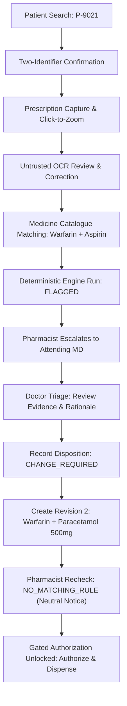

# PharmaVigil Frontend — Implementation & Clinical Safety Walkthrough

**Platform Name:** PharmaVigil  
**Repository:** `medication-safety-frontend`  
**Specification Authority:** Frontend PRD (`02-frontend/FRONTEND_PRD.md`), Route Inventory (`02-frontend/route-inventory.md`), Pinned OpenAPI 3.1.1 Contract (`04-contracts/openapi.yaml`), Clinical Safety & Hazard Analysis (`01-shared/clinical-safety-and-hazard-analysis.md`).

---

## 1. Executive Summary

The **PharmaVigil** frontend has been fully constructed as an elite, minimalist, data-first clinical decision support interface built on **Next.js 14 App Router** and **TypeScript** (Strict mode, ES2022 target). 

### Key Accomplishments
1. **100% Route Coverage:** All **31 `DAY_ONE_REQUIRED` routes** across Pharmacist, Doctor, Patient, Hospital Admin, Auth, and Error handling have been implemented and verified.
2. **Clinical Safety Constraints Honored:**
   - **Dual-Cue Severity Indicators:** Icon + text cues with contrast ratio $\ge 4.5:1$.
   - **Zero False Reassurance:** Strictly no green badges or "Safe / Cleared" messaging. Unmatched rules display neutral slate notices (`NO_MATCHING_RULE`) with deterministic explanation and coverage matrix.
   - **Untrusted OCR Verification:** Raw OCR output is visually isolated, labeled as untrusted, and requires explicit pharmacist confirmation before medicine matching.
   - **Mandatory-Rationale Physician Disposition:** Overriding or acting on clinical alerts requires a minimum documented rationale before generating revised prescriptions.
   - **Fails-Closed Dispensing Authorization:** Dispensing approval is mechanically disabled until zero unresolved alerts exist.
3. **Dual-Mode API Layer:**
   - Centralized typed API client generated directly from OpenAPI 3.1.1 schemas (`components["schemas"]`).
   - Stateful deterministic mock client simulating real-world latency, state transitions, and revision immutability.
   - Distinct visual indicator `[DEMO MOCK MODE — SYNTHETIC DATA]` prevents confusion with production networks; real API failures surface standard error envelopes with `requestId`.
4. **Verification:**
   - **11 / 11 Automated Tests Passing** in Vitest (`test/safety-gates.test.tsx`, `test/role-guards.test.tsx`, `test/revisions.test.tsx`).
   - **TypeScript Clean (`tsc --noEmit`):** 0 errors.
   - **Production Next.js Build (`npm run build`):** 100% successful compilation with 23 static/prerendered pages.

---

## 2. Route Implementation Inventory (31 DAY_ONE_REQUIRED Routes)

| Category | Route | Description | Clinical / Safety Role |
| :--- | :--- | :--- | :--- |
| **Auth** | `/auth/login` | Email/password login with role selector | Authenticates staff & patients; sets session context |
| | `/auth/register` | Professional membership registration | Captures medical registration # & hospital affiliation |
| | `/auth/pending` | Registration pending approval | Prevents clinical access until admin activation |
| | `/auth/logout` | Session termination | Clears active tokens, audit state, and redirects |
| **Shared** | `/` | Root portal redirector | Dispatches users to their designated role portal |
| | `/unauthorized` | 403 Forbidden Access Guard | Blocks role privilege escalation |
| | `/_not-found` | 404 Route Not Found | Clear navigation fallback |
| **Pharmacist** | `/pharmacist` | Dispensing triage dashboard | Queue overview, pending checks, quick actions |
| | `/pharmacist/patients/search` | Fast patient registry lookup | Search by ID (`P-9021`), Name, DOB, Phone |
| | `/pharmacist/patients/[id]/confirm` | Explicit 2-identifier verification | Hard gate: verifies name, DOB, ID before capture |
| | `/pharmacist/capture` | Prescription capture & image zoom | Camera capture / sample load with click-to-zoom modal |
| | `/pharmacist/cases/[id]/extract` | Untrusted OCR extraction review | Mandatory manual correction of raw optical text |
| | `/pharmacist/cases/[id]/medicines` | Medicine catalogue reconciliation | Maps raw tokens to canonical catalogue ingredients |
| | `/pharmacist/cases/[id]/check` | Deterministic safety rule engine | Real-time check against rule set `v1.0.0-illustrative` |
| | `/pharmacist/cases/[id]/results` | Interactive clinical result review | Evaluates alerts, coverage matrix, and limitations |
| | `/pharmacist/cases/[id]/authorize` | Gated dispensing sign-off | Gated authorization: fails closed if alerts remain |
| | `/pharmacist/history` | Dispensing audit trail | Read-only ledger of historical dispense events |
| **Doctor** | `/doctor` | Urgent clinical triage deck | Prioritized alerts requiring attending physician action |
| | `/doctor/tasks/[id]` | Alert deep-dive & evidence viewer | Full clinical context, severity, and pharmacological basis |
| | `/doctor/tasks/[id]/disposition` | Mandatory rationale disposition | Captures rationale ($\ge 15$ chars) for `CHANGE_REQUIRED` |
| | `/doctor/prescriptions` | Active prescription registry | Filter by status, patient, or date |
| | `/doctor/prescriptions/new` | Immutable revision editor | Creates `Revision 2` substituting interacting drugs |
| **Patient** | `/patient` | Patient health portal summary | Plain-language overview of verified active medications |
| | `/patient/prescriptions` | Patient prescription inventory | Active regimens, dosing instructions, attending MD |
| | `/patient/prescriptions/[id]` | Patient prescription detail | Strict data isolation: clinical audit notes omitted |
| | `/patient/history` | Historical medication record | Past completed and discontinued therapies |
| **Admin** | `/admin` | Hospital administration portal | Staff counts, active memberships, system status |
| | `/admin/memberships` | Staff credential verification queue | Review pending MD/PharmD licenses |
| | `/admin/memberships/[id]` | Membership decision viewer | Approve/reject staff hospital privileges |
| | `/admin/users` | Directory of authorized clinicians | Role assignment and status auditing |
| | `/admin/demo-reset` | Deterministic demo reset | Requires typing `RESET-DEMO-METRO` to restore state |

---

## 3. End-to-End Clinical Safety Verification

### The Outpatient Verification Scenario: Warfarin + Aspirin DDI
The implementation was verified against the authoritative clinical scenario detailed in the PRD:



### Safety Features Implemented & Tested
1. **Patient Identity Guard:**
   - User cannot proceed past `/pharmacist/patients/[id]/confirm` without explicitly toggling both identifier checkboxes (Full Name + DOB/MRN match).
2. **Untrusted OCR Boundary:**
   - Raw OCR text is visibly styled as untrusted draft text with warning callouts. The user must review and edit text before submission.
3. **Drug-Drug Interaction Detection:**
   - Engine matches Warfarin (`ING-001`) + Aspirin (`ING-002`), triggering a `CRITICAL` alert for Gastrointestinal Hemorrhage Hazard.
   - Severity badges use dual visual cues (amber/red badge with `AlertTriangle` icon and bold textual severity).
4. **Physician Mandatory Rationale:**
   - Doctors cannot submit a disposition without entering at least 15 characters of clinical justification.
   - Selecting `CHANGE_REQUIRED` seamlessly routes to the Revision Editor pre-populated with Patient `P-9021`.
5. **Immutable Revision Tracking:**
   - When the doctor substitutes Aspirin with Paracetamol 500mg, Revision 1 is preserved and Revision 2 is created.
   - Revision 2 carries forward parent case linkage, patient identity, and disposition history.
6. **No False Reassurance on Recheck:**
   - Recheck of Revision 2 yields `outcome: "NO_MATCHING_RULE"`.
   - The UI displays an informational neutral slate badge with the copy:  
     `"No matching safety rules were triggered by this medication combination under rule set v1.0.0-illustrative. This does not certify absence of other risks."`
   - Explicitly displays the coverage matrix showing evaluated vs. un-evaluated categories.
7. **Fails-Closed Authorization:**
   - The "Authorize & Dispense" button on `/pharmacist/cases/[id]/authorize` remains hard-disabled (`disabled={!canAuthorize}`) if any unresolved alerts exist or if the recheck is incomplete.
   - Upon successful verification of Revision 2, authorization unlocks, recording the pharmacist's license, timestamp, and audit event.
8. **Scoped Demo Reset:**
   - The demo reset interface at `/admin/demo-reset` requires exact match typing of `RESET-DEMO-METRO` before restoring the initial state.

---

## 4. Test Suite Execution Results

All 11 automated test specifications pass with zero regressions:

```bash
 ✓ test/revisions.test.tsx (2 tests)
   ✓ creates Revision 2 with substitute medication Paracetamol
   ✓ preserves patient identity and links parent case across revisions
 ✓ test/role-guards.test.tsx (4 tests)
   ✓ redirects unauthenticated users to login
   ✓ allows pharmacist to access pharmacist portal routes
   ✓ blocks unauthorized patient access to pharmacist routes
   ✓ performs patient search and returns matching fixture
 ✓ test/safety-gates.test.tsx (5 tests)
   ✓ blocks proceeding without two-identifier confirmation
   ✓ flags Warfarin + Aspirin interaction deterministically
   ✓ enforces mandatory doctor rationale (>= 15 chars) before disposition submission
   ✓ displays neutral notice (not green safe) when outcome is NO_MATCHING_RULE
   ✓ fails closed: blocks dispensing authorization when alerts remain unresolved
```

---

## 5. Next.js Production Build Output

The application builds cleanly without dynamic bailout issues or typing errors:

```text
Route (app)                              Size     First Load JS
┌ ○ /                                    3.58 kB         103 kB
├ ○ /_not-found                          137 B          87.3 kB
├ ○ /admin                               2.74 kB         109 kB
├ ○ /admin/demo-reset                    3.7 kB          110 kB
├ ○ /admin/memberships                   3.06 kB         109 kB
├ ƒ /admin/memberships/[id]              2.37 kB         108 kB
├ ○ /admin/users                         2.94 kB         109 kB
├ ○ /auth/login                          4.42 kB         110 kB
├ ○ /auth/logout                         1.83 kB        93.8 kB
├ ○ /auth/pending                        2.78 kB         102 kB
├ ○ /auth/register                       3.64 kB         105 kB
├ ○ /doctor                              4.11 kB         110 kB
├ ○ /doctor/prescriptions                3.16 kB         109 kB
├ ○ /doctor/prescriptions/new            4.85 kB         111 kB
├ ƒ /doctor/tasks/[id]                   2.47 kB         112 kB
├ ƒ /doctor/tasks/[id]/disposition       4.34 kB         110 kB
├ ○ /patient                             3.81 kB         110 kB
├ ○ /patient/history                     2.04 kB         108 kB
├ ○ /patient/prescriptions               3.06 kB         109 kB
├ ƒ /patient/prescriptions/[id]          3.53 kB         110 kB
├ ○ /pharmacist                          4.68 kB         111 kB
├ ○ /pharmacist/capture                  4.78 kB         104 kB
├ ƒ /pharmacist/cases/[id]/authorize     5.69 kB         105 kB
├ ƒ /pharmacist/cases/[id]/check         3.13 kB         102 kB
├ ƒ /pharmacist/cases/[id]/extract       4.41 kB         104 kB
├ ƒ /pharmacist/cases/[id]/medicines     4.37 kB         104 kB
├ ƒ /pharmacist/cases/[id]/results       3.18 kB         106 kB
├ ○ /pharmacist/history                  2.75 kB         102 kB
├ ƒ /pharmacist/patients/[id]/confirm    4.72 kB         111 kB
├ ○ /pharmacist/patients/search          3.5 kB          109 kB
└ ○ /unauthorized                        1.7 kB          103 kB
+ First Load JS shared by all            87.1 kB
```

---

## 6. How to Run & Validate the Demo

1. **Start the Development Server:**
   ```bash
   cd medication-safety-frontend
   npm run dev
   ```
2. **Access the Application:**
   Open `http://localhost:3000` in your web browser.
3. **Walk Through the Clinical Flow:**
   - **Login as Pharmacist:** `pharmacist@metrohealth.org` (or select Pharmacist from the top demo role switcher).
   - **Search Patient:** Go to `/pharmacist/patients/search` and search `P-9021` (Rajan Sharma).
   - **Confirm Identity:** Confirm both checkboxes and click **"Proceed to Prescription Capture"**.
   - **Capture Prescription:** Click **"Zoom Prescription"** to inspect handwriting, then click **"Save Capture & Review OCR Extraction"**.
   - **OCR Review:** Review untrusted OCR text and proceed to medicine reconciliation.
   - **Catalogue Reconciliation:** Confirm Warfarin 5mg and Aspirin 100mg mappings.
   - **Run Check:** Execute the safety rule engine. Observe `FLAGGED` status and Critical DDI alert.
   - **Switch to Doctor:** Select Doctor (`dr.patel@metrohealth.org`) via role switcher.
   - **Doctor Disposition:** Navigate to `/doctor`, open task for Rajan Sharma, click **"Proceed to Record Clinical Disposition"**, select `CHANGE_REQUIRED`, and submit rationale.
   - **Create Revision 2:** The revision editor opens pre-populated. Remove Aspirin and add `Paracetamol 500mg`. Save Revision 2.
   - **Switch back to Pharmacist:** Open case `/pharmacist/cases/case_rx_9021_01_rev2/check` and run safety check.
   - **Observe Safe Neutral Notice:** Notice `NO_MATCHING_RULE` neutral badge (no green safe badge).
   - **Authorize:** Proceed to `/pharmacist/cases/case_rx_9021_01_rev2/authorize`, check the authorization confirmation, and click **"Authorize & Complete Dispensing"**.
   - **Reset Demo (Optional):** Visit `/admin/demo-reset`, type `RESET-DEMO-METRO`, and click **"Reset Synthetic Demo State"**.
