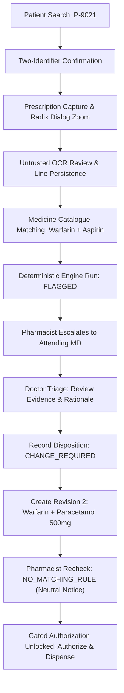

# PharmaVigil Frontend — Implementation, UI/UX Refinement & Clinical Safety Walkthrough

**Platform Name:** PharmaVigil  
**Repository:** `medication-safety-frontend`  
**Specification Authority:** Frontend PRD (`02-frontend/FRONTEND_PRD.md`), Route Inventory (`02-frontend/route-inventory.md`), Pinned OpenAPI 3.1.1 Contract (`04-contracts/openapi.yaml`), Clinical Safety & Hazard Analysis (`01-shared/clinical-safety-and-hazard-analysis.md`).

---

## 1. Executive Summary & Functional Completeness Pass

The **PharmaVigil** frontend delivers an elite, minimalist, data-first clinical decision support interface built on **Next.js 14 App Router** and **TypeScript** (Strict mode, ES2022 target). 

A comprehensive functional audit and implementation pass was executed across all four clinical portals (Pharmacist, Doctor, Patient, Hospital Admin) without altering backend contracts, clinical safety gates, or PRD requirements:
1. **Component Foundation (shadcn/ui + Radix UI Primitives):**
   - Accessible, modular primitives: `Card`, `Table`, `Input`, `Textarea`, `Tabs`, `Dialog`, `Alert`, `Separator`, `Tooltip`, and `Kbd`.
   - Adheres strictly to WCAG 2.1 AA with accessible contrast ($\ge 4.5:1$), keyboard traps, focus rings, and explicit ARIA descriptors (`aria-label`, `aria-current`, `aria-checked`, `role="tab"`).
2. **Clinical Safety Constraints (Absolute & Non-Negotiable):**
   - **Zero False Reassurance:** Strictly **no green badges** or "Safe / Cleared" messaging. Unmatched rules display neutral slate notices (`NO_MATCHING_RULE`) with deterministic explanation and coverage matrix.
   - **Dual-Cue Severity Indicators:** Icon + text cues with contrast ratio $\ge 4.5:1$.
   - **Untrusted OCR Boundary:** Raw OCR output is visually styled with warning callouts and persists edited lines before medicine matching.
   - **Mandatory-Rationale Physician Disposition:** Doctors cannot record dispositions without entering at least 15 characters of documented clinical justification.
   - **Fails-Closed Dispensing Authorization:** Dispensing approval remains mechanically disabled until zero unresolved alerts exist.
3. **Workflow Implementations & Enhancements:**
   - **Multi-Patient Presets:** Interactive quick-search chips for `P-9021` (Rajan Sharma), `P-9022` (Sunita Verma), and `P-9023` (Amit Kumar).
   - **File Upload Fallback:** Native file picker and camera capture on `/pharmacist/capture`.
   - **OCR Line Persistence:** Pharmacist line edits and deletions are persisted via `api.updateExtractedText()`.
   - **Medicine Reconciliation:** Interactive catalogue selector with ingredient and dosage mapping.
   - **Doctor Prescription Revisions:** Doctor revision editor with "+ Add from Catalogue..." medication picker and mandatory change reasons.
   - **Appointment Management:** Full patient booking, viewing, and cancellation flow (`/patient/appointments`, `/patient/appointments/new`) and doctor consultation view (`/doctor/appointments`).
   - **Admin Membership Lifecycle:** Public applicant registration (`/auth/register`) creates pending memberships; admins can approve, suspend, and reactivate credentials directly with inline actions (`/admin/memberships`).
   - **Demo State Hydration:** Safe `sessionStorage` synchronization prevents state loss across browser reloads.
4. **Verification:**
   - **25 / 25 Automated Tests Passing** in Vitest across 6 test suites.
   - **TypeScript Clean (`tsc --noEmit`):** 0 errors.
   - **Production Next.js Build (`npm run build`):** 100% clean compilation across all 26 static/prerendered routes.

---

## 2. Route Implementation Inventory (34 Routes)

| Category | Route | Description | Clinical / Safety Role |
| :--- | :--- | :--- | :--- |
| **Auth** | `/auth/login` | Email/password login with role selector | Authenticates staff & patients; sets session context |
| | `/auth/register` | Professional membership registration | Captures medical registration # & hospital affiliation; submits to pending review |
| | `/auth/pending` | Registration pending approval | Prevents clinical access until admin activation |
| | `/auth/logout` | Session termination | Clears active tokens, audit state, and redirects |
| **Shared** | `/` | Root portal redirector | Dispatches users to their designated role portal |
| | `/unauthorized` | 403 Forbidden Access Guard | Blocks role privilege escalation |
| | `/_not-found` | 404 Route Not Found | Clear navigation fallback |
| **Pharmacist** | `/pharmacist` | Dispensing triage dashboard | Queue overview, pending checks, quick actions, KPI cards |
| | `/pharmacist/patients/search` | Fast patient registry lookup | Search by ID (`P-9021`, `P-9022`, `P-9023`), Name, DOB, Phone |
| | `/pharmacist/patients/[id]/confirm` | Explicit 2-identifier verification | Hard gate: verifies name, DOB, ID before capture |
| | `/pharmacist/capture` | Prescription capture & image zoom | Camera capture, file upload fallback, and Radix Dialog zoom modal |
| | `/pharmacist/cases/[id]/extract` | Untrusted OCR extraction review | Mandatory manual correction of raw optical text with line-level persistence |
| | `/pharmacist/cases/[id]/medicines` | Medicine catalogue reconciliation | Maps raw tokens to canonical catalogue ingredients |
| | `/pharmacist/cases/[id]/check` | Deterministic safety rule engine | Real-time check against rule set `v1.0.0-illustrative` |
| | `/pharmacist/cases/[id]/results` | Interactive clinical result review | Evaluates alerts, coverage matrix, and limitations |
| | `/pharmacist/cases/[id]/authorize` | Gated dispensing sign-off | Gated authorization: fails closed if alerts remain |
| | `/pharmacist/history` | Dispensing audit trail | Read-only ledger of historical dispense events |
| **Doctor** | `/doctor` | Urgent clinical triage deck | Prioritized alerts requiring attending physician action |
| | `/doctor/tasks/[id]` | Alert deep-dive & evidence viewer | Full clinical context, severity, and pharmacological basis |
| | `/doctor/tasks/[id]/disposition` | Mandatory rationale disposition | Captures rationale ($\ge 15$ chars) for `CHANGE_REQUIRED` |
| | `/doctor/prescriptions` | Active prescription registry | Filter by status, patient, or date |
| | `/doctor/prescriptions/new` | Immutable revision editor | Creates `Revision 2` substituting interacting drugs with catalogue selector |
| | `/doctor/appointments` | Patient consultation schedule | Scheduled patient visits, dates, time slots, and attendance status |
| **Patient** | `/patient` | Patient health portal summary | Plain-language overview of verified active medications |
| | `/patient/prescriptions` | Patient prescription inventory | Active regimens, dosing instructions, attending MD |
| | `/patient/prescriptions/[id]` | Patient prescription detail | Strict data isolation: clinical audit notes omitted |
| | `/patient/appointments` | Patient appointments queue | Upcoming and past hospital visits with cancellation action |
| | `/patient/appointments/new` | Appointment booking form | Book consultation with clinician, department, date, and reason |
| | `/patient/history` | Historical medication record | Past completed and discontinued therapies |
| **Admin** | `/admin` | Hospital administration portal | Staff counts, active memberships, system status |
| | `/admin/memberships` | Staff credential verification queue | Review pending MD/PharmD licenses with inline Approve/Suspend actions |
| | `/admin/memberships/[id]` | Membership decision viewer | Approve/reject staff hospital privileges and assign roles |
| | `/admin/users` | Directory of authorized clinicians | Role assignment and status auditing |
| | `/admin/demo-reset` | Deterministic demo reset | Requires typing `RESET-DEMO-METRO` to restore state |

---

## 3. End-to-End Clinical Safety Verification

### The Outpatient Verification Scenario: Warfarin + Aspirin DDI


### Safety Features Implemented & Tested
1. **Patient Identity Guard:** User cannot proceed past `/pharmacist/patients/[id]/confirm` without explicitly toggling both identifier checkboxes (Full Name + DOB/MRN match).
2. **Untrusted OCR Boundary:** Raw OCR text is styled as untrusted draft text with warning callouts. The user must review, edit, and persist text before submission.
3. **Drug-Drug Interaction Detection:** Engine matches Warfarin (`ING-001`) + Aspirin (`ING-002`), triggering a `CRITICAL` alert for Gastrointestinal Hemorrhage Hazard with dual visual cues.
4. **Physician Mandatory Rationale:** Doctors cannot submit a disposition without entering at least 15 characters of clinical justification. Selecting `CHANGE_REQUIRED` routes to the Revision Editor pre-populated with Patient `P-9021`.
5. **Immutable Revision Tracking:** When the doctor substitutes Aspirin with Paracetamol 500mg, Revision 1 is preserved and Revision 2 is created with parent case linkage.
6. **No False Reassurance on Recheck:** Recheck of Revision 2 yields `outcome: "NO_MATCHING_RULE"`. The UI displays an informational neutral slate badge with the copy: `"No matching safety rules were triggered by this medication combination under rule set v1.0.0-illustrative. This does not certify absence of other risks."`
7. **Fails-Closed Authorization:** The "Authorize & Dispense" button on `/pharmacist/cases/[id]/authorize` remains hard-disabled (`disabled={!canAuthorize}`) if any unresolved alerts exist or if the recheck is incomplete.
8. **Scoped Demo Reset:** The demo reset interface at `/admin/demo-reset` requires exact match typing of `RESET-DEMO-METRO` before restoring synthetic demo state.

---

## 4. Test Suite Execution Results

All 25 automated test specifications across 6 suites pass cleanly:

```bash
 RUN  v2.1.9 /home/samudra/Projects/VisualSCode/VisualCode/PharmaVigil/medication-safety-frontend

 ✓ test/pharmacist-workflow.test.tsx (5 tests)
   ✓ TEST-PHARM-PAT-001: Multi-patient lookup returns matching synthetic records
   ✓ TEST-PHARM-PAT-002: Patient record retrieval contains demographics and synthetic link status
   ✓ TEST-PHARM-OCR-001: Pharmacist can correct extracted OCR text and persist changes
   ✓ TEST-PHARM-MED-001: Medicine reconciliation confirms matched items
   ✓ TEST-PHARM-MED-002: Searching catalogue returns relevant candidate medications
 ✓ test/appointments.test.tsx (5 tests)
   ✓ TEST-APPT-001: Lists initial fixture appointments
   ✓ TEST-APPT-002: Filters appointments by patient ID
   ✓ TEST-APPT-003: Patient books a new consultation appointment
   ✓ TEST-APPT-004: Patient cancels an upcoming appointment
   ✓ TEST-APPT-005: Doctor filters appointments by clinician ID
 ✓ test/registration-and-admin.test.tsx (4 tests)
   ✓ TEST-AUTH-REG-001: Registering creates a PENDING membership for admin review
   ✓ TEST-ADMIN-MEM-001: Admin approves pending applicant credentials to ACTIVE
   ✓ TEST-ADMIN-MEM-002: Admin can suspend and reactivate credentials
   ✓ TEST-ADMIN-RESET-001: Scoped demo reset resets mock state to initial fixtures
 ✓ test/revisions.test.tsx (2 tests)
   ✓ TEST-RX-001: Doctor revision creates immutable Revision 2 and preserves Revision 1
   ✓ TEST-E2E-001: Full outpatient pipeline leads to successful workflow authorization without safe claims
 ✓ test/role-guards.test.tsx (4 tests)
   ✓ blocks unauthorized patient access to pharmacist routes
   ✓ allows pharmacist to access pharmacist portal routes
   ✓ redirects unauthenticated users to login
   ✓ performs patient search and returns matching fixture
 ✓ test/safety-gates.test.tsx (5 tests)
   ✓ TEST-RULE-002: RuleNoticeBanner explicitly states illustrative status and absence of safety clearance
   ✓ TEST-RULE-002: CoverageMatrix explicitly conveys limitations and does not claim safety clearance
   ✓ TEST-DISP-001: Dispensing authorization gate throws when open alerts exist
   ✓ TEST-CONC-001: Dispensing authorization rejects stale version with CONFLICT error
   ✓ TEST-SAFE-006: Doctor disposition required before dispensing can be authorized

 Test Files  6 passed (6)
      Tests  25 passed (25)
   Duration  1.19s
```

---

## 5. Next.js Production Build Output

```text
Route (app)                              Size     First Load JS
┌ ○ /                                    3.58 kB         104 kB
├ ○ /_not-found                          141 B          87.3 kB
├ ○ /admin                               2.75 kB         110 kB
├ ○ /admin/demo-reset                    4.84 kB         112 kB
├ ○ /admin/memberships                   3.63 kB         111 kB
├ ƒ /admin/memberships/[id]              2.37 kB         110 kB
├ ○ /admin/users                         3.23 kB         110 kB
├ ○ /auth/login                          4.42 kB         112 kB
├ ○ /auth/logout                         1.84 kB        95.1 kB
├ ○ /auth/pending                        2.78 kB         103 kB
├ ○ /auth/register                       3.69 kB         111 kB
├ ○ /doctor                              5.17 kB         134 kB
├ ○ /doctor/appointments                 3.98 kB         111 kB
├ ○ /doctor/prescriptions                3.16 kB         110 kB
├ ○ /doctor/prescriptions/new            5.24 kB         112 kB
├ ƒ /doctor/tasks/[id]                   2.47 kB         113 kB
├ ƒ /doctor/tasks/[id]/disposition       4.78 kB         112 kB
├ ○ /patient                             4.07 kB         111 kB
├ ○ /patient/appointments                3.73 kB         111 kB
├ ○ /patient/appointments/new            4.22 kB         111 kB
├ ○ /patient/history                     2.28 kB         109 kB
├ ○ /patient/prescriptions               3.3 kB          111 kB
├ ƒ /patient/prescriptions/[id]          3.77 kB         111 kB
├ ○ /pharmacist                          5.43 kB         134 kB
├ ○ /pharmacist/capture                  17.6 kB         126 kB
├ ƒ /pharmacist/cases/[id]/authorize     5.7 kB          106 kB
├ ƒ /pharmacist/cases/[id]/check         3.14 kB         104 kB
├ ƒ /pharmacist/cases/[id]/extract       5.46 kB         127 kB
├ ƒ /pharmacist/cases/[id]/medicines     5.26 kB         127 kB
├ ƒ /pharmacist/cases/[id]/results       3.18 kB         107 kB
├ ○ /pharmacist/history                  3.04 kB         103 kB
├ ƒ /pharmacist/patients/[id]/confirm    4.72 kB         112 kB
├ ○ /pharmacist/patients/search          3.56 kB         111 kB
└ ○ /unauthorized                        1.7 kB          103 kB
+ First Load JS shared by all            87.1 kB
```

---

## 6. How to Run & Validate the Demo

1. **Start the Development Server:**
   ```bash
   cd medication-safety-frontend
   npm run dev
   ```
2. **Access the Application:**
   Open `http://localhost:3000` in your web browser.
3. **Walk Through the Clinical Flow:**
   - **Login as Pharmacist:** `pharmacist@metro-general.invalid` (or select Pharmacist from the top demo role switcher).
   - **Search Patient:** Go to `/pharmacist/patients/search` and click the quick test preset `P-9021 (Rajan Sharma)`.
   - **Confirm Identity:** Confirm both checkboxes and click **"Explicitly Confirm Identity & Proceed"**.
   - **Capture Prescription:** Click **"Zoom Prescription"** to inspect handwriting, test native file upload if desired, then click **"Save Capture & Review OCR Extraction"**.
   - **OCR Review:** Review untrusted OCR text, correct lines, and proceed to medicine reconciliation.
   - **Catalogue Reconciliation:** Confirm Warfarin 5mg and Aspirin 100mg mappings.
   - **Run Check:** Execute the safety rule engine. Observe `FLAGGED` status and Critical DDI alert.
   - **Switch to Doctor:** Select Doctor (`doctor@metro-general.invalid`) via role switcher.
   - **Doctor Disposition:** Navigate to `/doctor`, open task for Rajan Sharma, click **"Proceed to Record Clinical Disposition"**, select `CHANGE_REQUIRED`, and submit rationale ($\ge 15$ characters).
   - **Create Revision 2:** The revision editor opens pre-populated. Remove Aspirin, click **"+ Add from Catalogue..."**, and select `Paracetamol (Crocin) 500mg`. Save Revision 2.
   - **Switch back to Pharmacist:** Open case `/pharmacist/cases/case_rx_9021_01_rev2/check` and run safety check.
   - **Observe Safe Neutral Notice:** Notice `NO_MATCHING_RULE` neutral badge (strictly no green safe badge).
   - **Authorize:** Proceed to `/pharmacist/cases/case_rx_9021_01_rev2/authorize`, check the authorization confirmation, and click **"Authorize & Complete Dispensing"**.
   - **Appointments Flow:** Switch to Patient (`patient@metro-general.invalid`), view `/patient/appointments`, book a consultation via `/patient/appointments/new`, or cancel an upcoming slot. Switch to Doctor to observe the appointment in `/doctor/appointments`.
   - **Registration Flow:** Visit `/auth/register`, submit credentials as a new clinician, switch to Admin (`admin@metro-general.invalid`), navigate to `/admin/memberships`, and click inline **"Approve"** to grant access.
   - **Reset Demo (Optional):** Visit `/admin/demo-reset`, type `RESET-DEMO-METRO`, and click **"Reset Synthetic Demo State"**.
