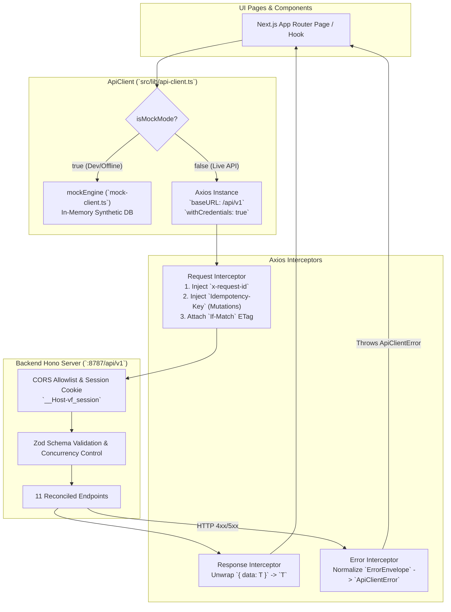

# Implementation Plan: Frontend Axios Networking & Contract Reconciliation

**Role:** Planner Subagent 1 — Frontend Axios Networking & Contract Reconciliation  
**Target Workspaces:**  
- Frontend: `/run/media/jimfleax/DEV/Projects/PharmaVigil-frontend`  
- Backend: `/run/media/jimfleax/DEV/Projects/PharmaVigil`  
**Artifact Path:** `/run/media/jimfleax/DEV/Projects/PharmaVigil-frontend/scratch/plannings/session-1-frontend-axios-api-reconciliation.plan.md`  

---

## 1. Executive Summary & Architecture Overview

The PharmaVigil frontend currently communicates with either an in-memory synthetic engine (`mock-client.ts`) or an experimental `fetch`-based client (`api-client.ts`). While the mock engine allows rapid UI prototyping and unit test execution, the `fetch`-based HTTP implementation exhibits major drift from the production Hono backend OpenAPI 3.1.0 contract:

1. **Missing Axios Infrastructure:** Raw `fetch` lacks centralized request/response interceptors, cookie management guarantees, standardized timeout handling, and automatic request cancellation.
2. **Schema & Header Contract Mismatches across 11 Core Endpoints:**
   - Missing `If-Match` optimistic concurrency headers required by backend endpoints (`/prescriptions/:id/revisions`, `/alerts/:id/disposition`, `/prescription-captures/:id/confirm`).
   - Query parameter mismatches (e.g., `?q=` instead of `?hospitalPatientId=` for patient search; `?q=` instead of `?query=` for catalogue search).
   - Payload mismatches (e.g., missing `confirmation` literal and `workspaceId` on `/demo/reset`; missing `captureMode` on `/prescription-captures`; missing `doctorUserId`, `startAt`, `endAt` on `/appointments`; nonexistent endpoint `/memberships/:id/status` instead of dedicated approve/reject/suspend routes).
3. **Missing Error & Envelope Normalization:** Backend wraps errors into `ErrorEnvelope` (`{ error: { code, message, requestId, details } }`) and responses into `{ data: T }`. The frontend client inconsistently parsed these envelopes.
4. **Missing Tooling & Linters:** Missing `.eslintrc.json`, `eslint`, and `eslint-config-next`, causing `npm run lint` to stall interactively.
5. **No Network Layer Test Suite:** No automated tests directly verified HTTP serialization, interceptor injection, or error mapping.

### High-Level Architecture Flow



---

## 2. Dependencies & Tooling Setup

### 2.1 Dependencies to Install
In `/run/media/jimfleax/DEV/Projects/PharmaVigil-frontend`:

1. **Production Dependencies:**
   - `axios` (`^1.7.0`): Enterprise HTTP client supporting interceptors, automatic JSON transformation, and Node/Browser isomorphic credentials.
2. **Development Dependencies:**
   - `axios-mock-adapter` (`^2.1.0`): High-speed, deterministic HTTP request mocking for Vitest without starting a live server.
   - `eslint` (`^8.57.0`) & `eslint-config-next` (`14.2.15`): Next.js core web vitals linter matching Next `14.2.15`.

**Execution Command:**
```bash
npm install axios
npm install -D axios-mock-adapter eslint@^8.57.0 eslint-config-next@14.2.15
```

### 2.2 ESLint Setup
Create `.eslintrc.json` at frontend root:
```json
{
  "extends": "next/core-web-vitals"
}
```

### 2.3 Environment Variable Setup
Create `.env.local` at frontend root (ignored in `.gitignore`):
```env
# Live Hono API Base URL
NEXT_PUBLIC_API_BASE_URL=http://localhost:8787/api/v1

# Toggle Synthetic Mocks (set to false for live backend integration)
NEXT_PUBLIC_ENABLE_MOCKS=false
```

Keep `.env.example` intact for documentation and onboarding.

---

## 3. Network Layer & Interceptor Design

### 3.1 Axios Instance Configuration
```typescript
import axios, { AxiosInstance, AxiosResponse, AxiosError, InternalAxiosRequestConfig } from 'axios';

export const API_BASE_URL = process.env.NEXT_PUBLIC_API_BASE_URL || 'http://localhost:8787/api/v1';

export const axiosInstance: AxiosInstance = axios.create({
  baseURL: API_BASE_URL,
  withCredentials: true, // Guarantees __Host-vf_session transmission
  timeout: 15000,
  headers: {
    'Content-Type': 'application/json',
  },
});
```

### 3.2 Request Interceptor
The request interceptor guarantees non-negotiable contract headers:
1. **Correlation Tracking (`x-request-id`):** If not present, generates a client-side UUID v4 (`crypto.randomUUID()` or crypto-fallback).
2. **Mutation Idempotency (`Idempotency-Key`):**
   - OpenAPI requirement: `minLength: 16, maxLength: 128`.
   - Automatically injected for all mutation methods (`POST`, `PUT`, `PATCH`, `DELETE`) if not explicitly specified.
   - Format: `idemp_${Date.now()}_${random12Chars}` (ensures uniqueness and satisfies length requirements).
3. **Concurrency Control (`If-Match`):**
   - Transmitted verbatim when supplied in request config headers.

```typescript
axiosInstance.interceptors.request.use(
  (config: InternalAxiosRequestConfig) => {
    // 1. Correlation ID
    if (!config.headers['x-request-id']) {
      const uuid = typeof crypto !== 'undefined' && crypto.randomUUID
        ? crypto.randomUUID()
        : `req_${Date.now()}_${Math.random().toString(36).substring(2, 10)}`;
      config.headers['x-request-id'] = uuid;
    }

    // 2. Dynamic Idempotency-Key for mutations
    const method = config.method?.toUpperCase();
    if (method && ['POST', 'PUT', 'PATCH', 'DELETE'].includes(method)) {
      if (!config.headers['Idempotency-Key']) {
        const timestamp = Date.now();
        const rand = Math.random().toString(36).substring(2, 12);
        config.headers['Idempotency-Key'] = `idemp_${timestamp}_${rand}`;
      }
    }

    return config;
  },
  (error) => Promise.reject(error)
);
```

### 3.3 Response Interceptor (Envelope Unwrapping)
The backend wraps successful responses into `{ data: T }` for almost all domain entities:
```typescript
axiosInstance.interceptors.response.use(
  (response: AxiosResponse) => {
    // Transparently unwraps { data: T } to T, while preserving raw payload if no wrapper exists
    if (response.data && typeof response.data === 'object' && 'data' in response.data) {
      return {
        ...response,
        data: response.data.data,
      };
    }
    return response;
  },
  (error: AxiosError) => {
    // Handled in Error Interceptor below
    return Promise.reject(normalizeAxiosError(error));
  }
);
```

### 3.4 Error Interceptor & Normalization
Backend returns structured `ErrorEnvelope`:
```json
{
  "error": {
    "code": "VALIDATION_ERROR",
    "message": "The submitted request payload failed schema validation.",
    "requestId": "req_12345",
    "details": [{ "field": "items.0.brandText", "code": "invalid_type", "message": "Required" }]
  }
}
```

The error normalizer translates `AxiosError` into strongly typed `ApiClientError`:
```typescript
export class ApiClientError extends Error {
  code: string;
  requestId?: string;
  statusCode?: number;
  details?: Array<{ field?: string; message: string; code?: string }>;

  constructor(
    message: string,
    code: string = "INTERNAL_ERROR",
    requestId?: string,
    details?: Array<{ field?: string; message: string; code?: string }>,
    statusCode?: number
  ) {
    super(message);
    this.name = "ApiClientError";
    this.code = code;
    this.requestId = requestId;
    this.details = details;
    this.statusCode = statusCode;
  }
}

function normalizeAxiosError(error: AxiosError<any>): ApiClientError {
  const res = error.response;
  const requestId = (res?.headers?.['x-request-id'] as string) || res?.data?.error?.requestId;

  if (res?.data?.error) {
    const errData = res.data.error;
    return new ApiClientError(
      errData.message || error.message || 'Request failed',
      errData.code || `HTTP_${res.status}`,
      requestId,
      errData.details,
      res.status
    );
  }

  if (res) {
    const status = res.status;
    const defaultCodes: Record<number, string> = {
      400: 'BAD_REQUEST',
      401: 'UNAUTHENTICATED',
      403: 'FORBIDDEN',
      404: 'NOT_FOUND',
      409: 'CONFLICT',
      422: 'VALIDATION_ERROR',
      429: 'RATE_LIMITED',
      503: 'SERVICE_UNAVAILABLE',
    };
    const code = defaultCodes[status] || `HTTP_${status}`;
    return new ApiClientError(
      res.statusText || error.message || `Request failed with status ${status}`,
      code,
      requestId,
      undefined,
      status
    );
  }

  return new ApiClientError(error.message || 'Network connection failed.', 'NETWORK_FAILURE');
}
```

---

## 4. Method-by-Method Contract Reconciliation (11 Endpoints)

| # | Client Method | Backend Route & Verb | Request Headers | Request Body Schema | Expected Response |
|---|---|---|---|---|---|
| **1** | `runCheck` | `POST /checks` | `Idempotency-Key` | `{ subjectType: 'PRESCRIPTION_REVISION', subjectId: string, subjectVersion: number }` | `{ data: CheckEnvelope['data'] }` |
| **2** | `createRevision` | `POST /prescriptions/:id/revisions` | `If-Match: "{version}"`, `Idempotency-Key` | `{ items: PrescriptionItem[], changeReason: string, expectedVersion: number }` | `{ data: PrescriptionEnvelope['data'] }` |
| **3** | `recordDoctorDisposition` | `POST /alerts/:id/disposition` | `If-Match: "{version}"`, `Idempotency-Key` | `{ dispositionType: 'CHANGE_REQUIRED' \| 'CLINICALLY_REVIEWED' \| 'OTHER_DOCUMENTED', rationale: string }` | `{ data: AlertEnvelope['data'] }` |
| **4** | `confirmMedicines` | `POST /prescription-captures/:id/confirm` | `If-Match: "{version}"`, `Idempotency-Key` | `{ patientConfirmed: true, items: PrescriptionItem[] }` | `{ data: CaptureEnvelope['data'] }` |
| **5** | `searchPatients` | `GET /patients/search` | — | Query: `?hospitalPatientId={id}` (len: 3-64) | `{ data: PatientSummary[] }` |
| **6** | `searchCatalogue` | `GET /medicine-catalogue/search` | — | Query: `?query={query}&limit={limit}` | `{ data: MedicineCandidate[] }` |
| **7** | `createCapture` | `POST /prescription-captures` | `Idempotency-Key` | `{ patientId: string, captureMode: 'BROWSER_OCR' \| 'MANUAL_ENTRY' \| 'SEEDED_IMAGE', ocrLanguage?: 'eng', extractedText?: string }` | `{ data: CaptureEnvelope['data'] }` |
| **8** | `createAppointment` | `POST /appointments` | `Idempotency-Key` | `{ patientId: string, doctorUserId: string, startAt: ISO8601, endAt: ISO8601, reason?: string }` | `{ data: Appointment }` |
| **9** | `resetDemoWorkspace` | `POST /demo/reset` | `Idempotency-Key` | `{ confirmation: 'RESET_SYNTHETIC_DEMO', workspaceId: string }` | Status 202 `{ message: string }` |
| **10** | `seedDemoWorkspace` | `POST /demo/seed` | `Idempotency-Key` | `{ confirmation: 'SEED_SYNTHETIC_DEMO', workspaceId: string }` | Status 202 `{ message: string }` |
| **11a** | `approveMembership` | `POST /memberships/:id/approve` | `Idempotency-Key` | `{ assignedRole: Role, expectedVersion: number, reason?: string }` | `{ data: Membership }` |
| **11b** | `rejectMembership` | `POST /memberships/:id/reject` | — | `{ expectedVersion: number, reason?: string }` | `{ message: string }` |
| **11c** | `suspendMembership` | `POST /memberships/:id/suspend` | — | `{ expectedVersion: number, reason: string }` | `{ message: string }` |
| **11d** | `updateMembershipStatus` | Router facade | — | Dispatches to `approve`, `reject`, or `suspend` based on status argument | `{ data: Membership }` or `{ message: string }` |

### Detailed Method Specifications & Signatures

#### Method 1: `runCheck`
```typescript
interface RunCheckParams {
  subjectType?: 'PRESCRIPTION_REVISION' | 'MEDICATION_ORDER_VERSION';
  subjectId: string;
  subjectVersion?: number;
}

async runCheck(
  target: string | RunCheckParams,
  subjectVersion: number = 1
): Promise<CheckEnvelope>
```
- **Live Implementation:**
  ```typescript
  const body = typeof target === 'string'
    ? { subjectType: 'PRESCRIPTION_REVISION', subjectId: target, subjectVersion }
    : {
        subjectType: target.subjectType || 'PRESCRIPTION_REVISION',
        subjectId: target.subjectId,
        subjectVersion: target.subjectVersion ?? 1,
      };
  return this.post<CheckEnvelope>('/checks', body);
  ```
- **Mock Mode:** Passes `subjectId` to `mockEngine.runCheck(caseId)`.

#### Method 2: `createRevision`
```typescript
async createRevision(
  prescriptionId: string,
  items: PrescriptionItem[],
  changeReason: string,
  expectedVersion: number = 1
): Promise<FixtureCase>
```
- **Live Implementation:**
  ```typescript
  return this.post<FixtureCase>(
    `/prescriptions/${prescriptionId}/revisions`,
    { items, changeReason, expectedVersion },
    { 'If-Match': String(expectedVersion) }
  );
  ```

#### Method 3: `recordDoctorDisposition`
```typescript
async recordDoctorDisposition(
  alertId: string,
  dispositionType: 'CHANGE_REQUIRED' | 'CLINICALLY_REVIEWED' | 'OTHER_DOCUMENTED',
  rationale: string,
  expectedVersion: number = 1
): Promise<void>
```
- **Live Implementation:**
  ```typescript
  await this.post(
    `/alerts/${alertId}/disposition`,
    { dispositionType, rationale },
    { 'If-Match': String(expectedVersion) }
  );
  ```

#### Method 4: `confirmMedicines`
```typescript
async confirmMedicines(
  caseId: string,
  items: PrescriptionItem[],
  expectedVersion: number = 1
): Promise<FixtureCase>
```
- **Live Implementation:**
  ```typescript
  return this.post<FixtureCase>(
    `/prescription-captures/${caseId}/confirm`,
    { patientConfirmed: true, items },
    { 'If-Match': String(expectedVersion) }
  );
  ```

#### Method 5: `searchPatients`
```typescript
async searchPatients(hospitalPatientId: string): Promise<PatientRecord[]>
```
- **Live Implementation:**
  ```typescript
  return this.get<PatientRecord[]>(
    `/patients/search?hospitalPatientId=${encodeURIComponent(hospitalPatientId)}`
  );
  ```

#### Method 6: `searchCatalogue`
```typescript
async searchCatalogue(query: string, limit: number = 20): Promise<MedicineCandidate[]>
```
- **Live Implementation:**
  ```typescript
  return this.get<MedicineCandidate[]>(
    `/medicine-catalogue/search?query=${encodeURIComponent(query)}&limit=${limit}`
  );
  ```

#### Method 7: `createCapture`
```typescript
interface CreateCaptureInput {
  patientId: string;
  captureMode?: 'BROWSER_OCR' | 'MANUAL_ENTRY' | 'SEEDED_IMAGE';
  ocrLanguage?: 'eng';
  extractedText?: string;
  rawExtractedText?: string;
  extractedFields?: unknown;
}

async createCapture(
  patientIdOrData: string | CreateCaptureInput,
  rawText?: string,
  mode: 'BROWSER_OCR' | 'MANUAL_ENTRY' | 'SEEDED_IMAGE' = 'BROWSER_OCR'
): Promise<FixtureCase>
```
- **Live Implementation:**
  ```typescript
  const payload = typeof patientIdOrData === 'string'
    ? {
        patientId: patientIdOrData,
        captureMode: mode,
        ocrLanguage: 'eng',
        extractedText: rawText || '',
      }
    : {
        patientId: patientIdOrData.patientId,
        captureMode: patientIdOrData.captureMode || 'BROWSER_OCR',
        ocrLanguage: patientIdOrData.ocrLanguage || 'eng',
        extractedText: patientIdOrData.extractedText || patientIdOrData.rawExtractedText || '',
      };
  return this.post<FixtureCase>('/prescription-captures', payload);
  ```

#### Method 8: `createAppointment`
```typescript
interface CreateAppointmentInput {
  patientId: string;
  doctorUserId?: string;
  clinicianUserId?: string;
  startAt?: string;
  slotStart?: string;
  endAt?: string;
  slotEnd?: string;
  reason?: string;
  patientDisplayName?: string;
  clinicianDisplayName?: string;
  department?: string;
}

async createAppointment(data: CreateAppointmentInput): Promise<AppointmentRecord>
```
- **Live Implementation:**
  ```typescript
  const payload = {
    patientId: data.patientId,
    doctorUserId: data.doctorUserId || data.clinicianUserId || '',
    startAt: data.startAt || data.slotStart || new Date().toISOString(),
    endAt: data.endAt || data.slotEnd || new Date(Date.now() + 30 * 60000).toISOString(),
    reason: data.reason || 'General Consultation',
  };
  return this.post<AppointmentRecord>('/appointments', payload);
  ```

#### Method 9 & 10: `resetDemoWorkspace` & `seedDemoWorkspace`
```typescript
async resetDemoWorkspace(
  workspaceId: string = 'ws_metro_default',
  confirmation: 'RESET_SYNTHETIC_DEMO' = 'RESET_SYNTHETIC_DEMO'
): Promise<void> {
  if (this.isMockMode) return mockEngine.resetDemoWorkspace();
  await this.post('/demo/reset', { confirmation, workspaceId });
}

async seedDemoWorkspace(
  workspaceId: string = 'ws_metro_default',
  confirmation: 'SEED_SYNTHETIC_DEMO' = 'SEED_SYNTHETIC_DEMO'
): Promise<void> {
  if (this.isMockMode) return;
  await this.post('/demo/seed', { confirmation, workspaceId });
}
```

#### Method 11: `memberships` (Approve, Reject, Suspend, and Facade)
```typescript
async approveMembership(
  membershipId: string,
  options: {
    assignedRole: 'PATIENT' | 'DOCTOR' | 'PHARMACIST' | 'HOSPITAL_ADMIN';
    expectedVersion?: number;
    reason?: string;
  }
): Promise<HospitalMemberRecord> {
  return this.post<HospitalMemberRecord>(`/memberships/${membershipId}/approve`, {
    assignedRole: options.assignedRole,
    expectedVersion: options.expectedVersion ?? 0,
    reason: options.reason,
  });
}

async rejectMembership(
  membershipId: string,
  options: { expectedVersion?: number; reason?: string } = {}
): Promise<{ message: string }> {
  return this.post<{ message: string }>(`/memberships/${membershipId}/reject`, {
    expectedVersion: options.expectedVersion ?? 0,
    reason: options.reason,
  });
}

async suspendMembership(
  membershipId: string,
  options: { reason: string; expectedVersion?: number }
): Promise<{ message: string }> {
  return this.post<{ message: string }>(`/memberships/${membershipId}/suspend`, {
    reason: options.reason,
    expectedVersion: options.expectedVersion ?? 0,
  });
}

// Backward-compatible facade for existing UI components
async updateMembershipStatus(
  id: string,
  status: 'ACTIVE' | 'PENDING' | 'SUSPENDED' | 'REVOKED',
  role?: 'PATIENT' | 'DOCTOR' | 'PHARMACIST' | 'HOSPITAL_ADMIN',
  expectedVersion: number = 0
) {
  if (this.isMockMode) {
    return mockEngine.updateMembershipStatus(id, status, role);
  }
  if (status === 'ACTIVE') {
    return this.approveMembership(id, { assignedRole: role || 'PATIENT', expectedVersion });
  } else if (status === 'SUSPENDED') {
    return this.suspendMembership(id, { reason: 'Suspended by admin', expectedVersion });
  } else if (status === 'REVOKED') {
    return this.rejectMembership(id, { reason: 'Revoked by admin', expectedVersion });
  }
  throw new ApiClientError(`Cannot update membership directly to status ${status}`, 'INVALID_ACTION');
}
```

---

## 5. TDD Testing Plan with Vitest & `axios-mock-adapter`

A comprehensive dedicated test suite `tests/api-client.test.ts` will verify the network layer under isolated conditions with zero dependency on a live server.

### 5.1 Test Cases Specification

```
tests/api-client.test.ts
├── 1. Core Axios Configuration
│   ├── verifies baseURL defaults to http://localhost:8787/api/v1
│   └── verifies withCredentials is enabled (true)
├── 2. Request Interceptors
│   ├── injects x-request-id header when not provided
│   ├── injects dynamic Idempotency-Key on POST/PUT/PATCH/DELETE mutations (length >= 16)
│   ├── preserves explicitly provided Idempotency-Key
│   └── does not inject Idempotency-Key on GET requests
├── 3. Response Interceptor & Envelope Unwrapping
│   ├── unwraps { data: T } to T automatically
│   └── passes through raw response when no data wrapper exists
├── 4. Error Normalization
│   ├── normalizes backend ErrorEnvelope into ApiClientError (code, message, requestId, details)
│   ├── maps HTTP 401 to code UNAUTHENTICATED
│   ├── maps HTTP 403 to code FORBIDDEN
│   ├── maps HTTP 409 to code CONFLICT
│   └── maps network drops / timeouts to NETWORK_FAILURE
└── 5. Reconciled Contract Endpoints Verification
    ├── POST /checks sends { subjectType, subjectId, subjectVersion }
    ├── POST /prescriptions/:id/revisions passes { items, changeReason, expectedVersion } & If-Match header
    ├── POST /alerts/:id/disposition passes { dispositionType, rationale } & If-Match header
    ├── POST /prescription-captures/:id/confirm passes { patientConfirmed: true, items } & If-Match header
    ├── GET /patients/search passes ?hospitalPatientId=...
    ├── GET /medicine-catalogue/search passes ?query=...
    ├── POST /prescription-captures passes { patientId, captureMode, extractedText }
    ├── POST /appointments maps clinicianUserId/slotStart to { doctorUserId, startAt, endAt }
    ├── POST /demo/reset passes { confirmation: 'RESET_SYNTHETIC_DEMO', workspaceId }
    ├── POST /demo/seed passes { confirmation: 'SEED_SYNTHETIC_DEMO', workspaceId }
    └── POST /memberships/:id/approve, reject, suspend called correctly via facade
```

---

## 6. Execution Phases & Step-by-Step Milestones

### Phase 1: Tooling & Dependency Installation
- Run `npm install axios`
- Run `npm install -D axios-mock-adapter eslint@^8.57.0 eslint-config-next@14.2.15`
- Create `.eslintrc.json` with `{"extends": "next/core-web-vitals"}`
- Create `.env.local` with `NEXT_PUBLIC_API_BASE_URL=http://localhost:8787/api/v1` and `NEXT_PUBLIC_ENABLE_MOCKS=false`
- Validate with `npm run lint` and `npm run typecheck`

### Phase 2: TDD Test Suite Creation (Red Stage)
- Create `tests/api-client.test.ts` implementing the full matrix of tests using `axios-mock-adapter`.
- Verify failing tests before rewrite.

### Phase 3: Client Implementation & Interceptor Wiring (Green Stage)
- Rewrite `src/lib/api-client.ts`:
  - Export `axiosInstance`, `ApiClientError`, `ApiClient`, and default singleton `api`.
  - Install Request, Response, and Error interceptors.
  - Implement all 11 reconciled domain methods.
  - Implement backward-compatible mock delegates when `isMockMode === true`.
- Run `npm test` and iterate until `tests/api-client.test.ts` and all 6 existing component test suites pass 100%.

### Phase 4: Full Verification & Sanity Check
- Run `npm test` -> 7 test suites, all passing.
- Run `npm run typecheck` -> 0 errors.
- Run `npm run lint` -> 0 errors.

---

## 7. Definition of Done & Success Metrics

1. **Zero Mismatches with OpenAPI:** All 11 endpoint methods strictly match `docs/04-contracts/openapi.yaml` and Hono routes.
2. **Zero Regressions in Mock Mode:** All 26 existing UI component tests pass cleanly.
3. **Robust Network Interceptors:** Tested handling of `x-request-id`, `Idempotency-Key`, `If-Match`, `{ data: T }` unwrapping, and `ApiClientError` normalization.
4. **Clean Tooling:** `npm run lint` executes without interactive prompts and completes with 0 errors.
