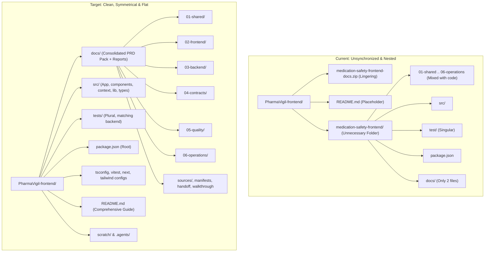

# Implementation Plan: Repository Directory Restructure & Synchronization

Restructure the **PharmaVigil-frontend** repository to eliminate the unnecessary and unprofessional nested `medication-safety-frontend/` wrapper folder, consolidate all PRD and documentation assets into `docs/` (mirroring the backend `../PharmaVigil` architecture), verify and safely remove `medication-safety-frontend-docs.zip`, standardize test directory naming, and establish a production-grade root `README.md`.

---

## 1. Goal Description

### Current Architecture Issues
1. **Unnecessary Nested Directory:** The entire application source code, configuration files, and `node_modules` are trapped inside a redundant subfolder `medication-safety-frontend/`. Anyone cloning the repo expects to run commands at the repository root, not navigate inside a nested folder.
2. **Scattered PRD & Documentation Pack:** The 26 documentation pack files (`01-shared/`, `02-frontend/`, `03-backend/`, `04-contracts/`, `05-quality/`, `06-operations/`, `sources/`, `package-manifest.json`, `project-manifest.json`, pack `README.md`, `REPO-HANDOFF.md`) are currently mixed into `medication-safety-frontend/` alongside `src/` and `package.json`, while only two files sit in `medication-safety-frontend/docs/`. In contrast, the backend repo (`../PharmaVigil`) cleanly stores all documentation in `docs/`.
3. **Lingering Zip File:** `medication-safety-frontend-docs.zip` remains in the root directory.
4. **Discrepancy with Backend Repository Structure:** In `../PharmaVigil`, the project root houses `src/`, `tests/`, `docs/`, `scratch/`, and root config files. In frontend, tests are named `test/` instead of `tests/`, and contract path in `package.json` (`generate:types`) points to `04-contracts/openapi.yaml` instead of `docs/04-contracts/openapi.yaml`.
5. **Bare Placeholder Root README:** The repository root `README.md` only contains `# PharmaVigil`, unlike the backend's comprehensive architectural guide.

### Target State
The frontend repository will become a direct twin of the backend repository:
- All Next.js source code sits directly at the root (`src/`, `tests/`, `package.json`, `tsconfig.json`, `next.config.mjs`, `tailwind.config.ts`, `vitest.config.ts`).
- All 26 documentation pack items plus existing completeness/walkthrough docs are consolidated under `docs/`.
- `medication-safety-frontend-docs.zip` is removed after verified extraction.
- The nested folder `medication-safety-frontend` is completely eliminated.
- A high-standard root `README.md` documents the architecture, tech stack, directory tree, and non-negotiable safety rules.

---

## 2. Directory Architecture Comparison



---

## 3. User Review Required

> [!IMPORTANT]
> - **Moving files with `git mv`:** All tracked files will be moved using `git mv` so Git retains 100% commit history and blame attribution without churn.
> - **Test Directory Renaming:** `medication-safety-frontend/test/` will be moved to `tests/` to match the backend's `tests/` directory naming convention. `vitest.config.ts` and `tsconfig.json` will be updated accordingly.
> - **Contract Path Update:** `package.json`'s `"generate:types"` script will be updated from `04-contracts/openapi.yaml` to `docs/04-contracts/openapi.yaml`.
> - **Zip Removal:** `medication-safety-frontend-docs.zip` will be deleted with `git rm` after re-verifying that all 26 files are preserved inside `docs/`.

---

## 4. Proposed Changes

### Documentation Consolidation (`docs/`)

#### [NEW / MOVE] `docs/`
Consolidate all documentation pack files and frontend report artifacts into the root `docs/` folder:
- `docs/01-shared/` (`clinical-safety-and-hazard-analysis.md`, `decision-register-and-assumptions.md`, `glossary-and-requirements.md`, `market-and-competitor-research.md`, `product-vision-and-scope.md`, `research-findings-and-open-questions.md`)
- `docs/02-frontend/` (`FRONTEND_PRD.md`, `ai-agent-workflow.md`, `route-inventory.md`)
- `docs/03-backend/` (`BACKEND_PRD.md`, `ai-agent-workflow.md`, `clinical-rule-data-spec.md`, `data-model.md`, `endpoint-inventory.md`)
- `docs/04-contracts/` (`integration-contract.md`, `openapi.yaml`)
- `docs/05-quality/` (`test-strategy.md`, `traceability-and-release-checklist.md`)
- `docs/06-operations/` (`demo-script-and-known-limitations.md`, `deployment-and-operations.md`, `one-day-implementation-plan.md`)
- `docs/sources/` (`source-register.md`)
- `docs/package-manifest.json`
- `docs/project-manifest.json`
- `docs/README.md` (The documentation pack index)
- `docs/REPO-HANDOFF.md`
- `docs/feature-completeness-matrix.md` (Retained from `medication-safety-frontend/docs/`)
- `docs/walkthrough.md` (Retained from `medication-safety-frontend/docs/`)

#### [DELETE] `medication-safety-frontend-docs.zip`
Remove the 52KB archive via `git rm` after verifying that all 26 archived files exist byte-identically in `docs/`.

---

### Application Source & Tests (`src/`, `tests/`)

#### [MOVE] `medication-safety-frontend/src` $\rightarrow$ `src`
All frontend application source code moved to root:
- `src/app/` (All 34 App Router routes: auth, pharmacist, doctor, patient, admin)
- `src/components/` (shadcn/ui, Radix, clinical cards, steppers, notice banners)
- `src/context/` (Auth & Demo Workspace state)
- `src/lib/` (API client, synthetic fixture engine, utility functions)
- `src/types/` (TypeScript contracts and domain schemas)

#### [MOVE] `medication-safety-frontend/test` $\rightarrow$ `tests`
Move and standardize test folder to `tests/` (plural, matching `../PharmaVigil/tests`):
- `tests/appointments.test.tsx`
- `tests/pharmacist-workflow.test.tsx`
- `tests/registration-and-admin.test.tsx`
- `tests/revisions.test.tsx`
- `tests/role-guards.test.tsx`
- `tests/safety-gates.test.tsx`
- `tests/setup.ts`

---

### Configuration Files (Root Level)

#### [MOVE] Config files from `medication-safety-frontend/` to root:
- `next.config.mjs`
- `next-env.d.ts`
- `package.json`
- `package-lock.json`
- `postcss.config.mjs`
- `tailwind.config.ts`
- `tsconfig.json`
- `vitest.config.ts`
- `.env.example`
- `.gitignore` (Merge `.next/`, `node_modules/`, etc. with root gitignore)

#### [MODIFY] `package.json`
Update script path to reflect `docs/04-contracts`:
```json
"scripts": {
  "dev": "next dev",
  "build": "next build",
  "start": "next start",
  "lint": "next lint",
  "typecheck": "tsc --noEmit",
  "test": "vitest run",
  "test:watch": "vitest",
  "generate:types": "openapi-typescript docs/04-contracts/openapi.yaml -o src/types/api.generated.ts"
}
```

#### [MODIFY] `vitest.config.ts`
Update setup path to reflect `tests/setup.ts`:
```typescript
import { defineConfig } from "vitest/config";
import path from "path";

export default defineConfig({
  test: {
    environment: "jsdom",
    globals: true,
    setupFiles: ["./tests/setup.ts"],
  },
  resolve: {
    alias: {
      "@": path.resolve(__dirname, "./src"),
    },
  },
});
```

#### [MODIFY] `tsconfig.json`
Update exclude path to `tests/**/*`:
```json
"exclude": ["node_modules", "vitest.config.ts", "tests/**/*"]
```

---

### Repository Root README

#### [MODIFY] `README.md`
Replace the 1-line placeholder `# PharmaVigil` with a comprehensive project documentation matching the tone, polish, and structure of `../PharmaVigil/README.md`:
- **Header & Badges:** Next.js 14, TypeScript 5, Tailwind CSS, shadcn/ui, Vitest, Strict Clinical Safety.
- **Project Overview:** Clinical decision support UI for Outpatient Medication Safety, 4 role portals (Pharmacist, Doctor, Patient, Hospital Admin).
- **Tech Stack Table:** Next.js 14 App Router, Radix UI primitives, DaisyUI utility prefix, Mantine hotkeys, Vitest + RTL.
- **Target Project Directory Structure Tree:** Complete diagram showing `docs/`, `src/`, `tests/`, `scratch/`.
- **Getting Started Guide:** `npm install`, `cp .env.example .env.local`, `npm run dev`.
- **Available Scripts:** `dev`, `build`, `start`, `lint`, `typecheck`, `test`, `generate:types`.
- **Non-Negotiable Safety Principles:** Zero false reassurance (no green badges for `NO_MATCHING_RULE`), untrusted OCR gate, mandatory rationale on doctor dispositions, fails-closed dispensing authorization.

---

### Elimination of Nested Directory

#### [DELETE] `medication-safety-frontend/`
Once all files are moved, the empty directory `medication-safety-frontend/` is removed.

---

## 5. Verification Plan

### Automated Tests & Quality Gates
Execute from the repository root:
1. **Dependency Integrity:**
   ```bash
   npm run typecheck
   ```
   *Expected:* 0 TypeScript compiler errors.

2. **Automated Unit & Workflow Tests:**
   ```bash
   npm test
   ```
   *Expected:* 26/26 tests pass across all 6 test suites in `tests/`.

3. **Production Build:**
   ```bash
   npm run build
   ```
   *Expected:* 100% clean Next.js production build compiling all 26 static/dynamic routes.

4. **Git Status & History Hygiene:**
   ```bash
   git status
   ```
   *Expected:* All tracked files properly recognized as renamed/moved (`R100`), zip file removed, and no orphan files.

### Manual Verification
1. Verify `docs/` contains all 26 documentation pack files matching `../PharmaVigil/docs/`.
2. Inspect root directory: verify no subfolder named `medication-safety-frontend` exists.
3. Review `README.md` to ensure clarity, completeness, and visual parity with the backend documentation.
