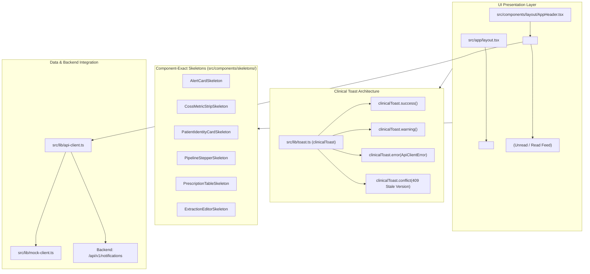
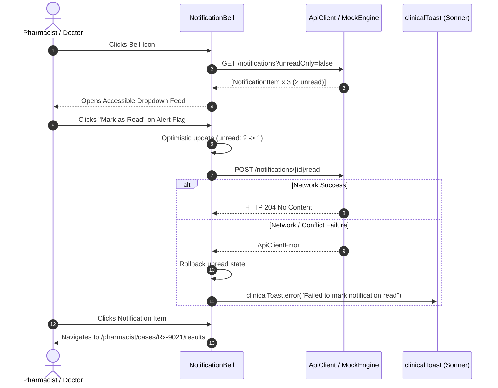
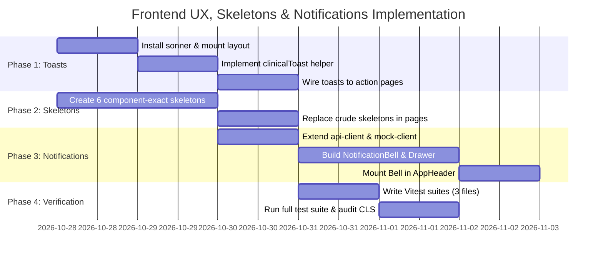

# Implementation Plan: Frontend UX Feedback, Sonner Toasts, Component-Exact Skeletons & In-App Notifications Center

**Project:** PharmaVigil — Hospital Outpatient Medication Safety Platform  
**Target Repositories:**  
- Frontend: `/run/media/jimfleax/DEV/Projects/PharmaVigil-frontend`  
- Backend: `/run/media/jimfleax/DEV/Projects/PharmaVigil`  
**Document Path:** `scratch/plannings/session-2-frontend-ux-skeletons-notifications.plan.md`  
**Author:** Planner Subagent 2 (UX Feedback, Sonner Toasts, Skeletons & Notification Center)

---

## 1. Executive Summary & Architectural Overview

The PharmaVigil frontend currently lacks interactive feedback notifications (action pages execute mutations with only inline state changes), relies on crude block skeletons (`<Skeleton className="h-64 w-full" />`) that trigger significant layout shift (Cumulative Layout Shift > 0.25), and lacks an In-App Notifications Center to alert clinicians and pharmacists of pending safety flags, dispositions, or appointment bookings.

This implementation plan establishes a four-pillar clinical UX upgrade:
1. **Sonner Clinical Toasts:** Integration of `sonner` with custom clinical theme tokens, error-envelope parser (extracting `requestId`, `code`, and RFC-7807/OpenAPI details), and optimistic concurrency conflict (409) refresh prompts.
2. **Component-Exact Loading Skeletons:** Elimination of generic rectangular gray placeholders in favor of 6 pixel-matched, zero-layout-shift skeletons mirroring live clinical components.
3. **In-App Notifications Center:** Real-time bell counter in `AppHeader`, priority badges (`CRITICAL`, `WARNING`, `INFO`), accessible slide-over/popover drawer, optimistic "mark-as-read", and background focus revalidation connected to existing `/api/v1/notifications` backend routes.
4. **TDD Verification Suite:** Vitest unit and integration suites verifying zero-CLS structural contracts, toast event emissions, and notification feed interactions.



---

## 2. Pillar 1: Sonner Toaster Integration & Clinical Toast Architecture

### 2.1 Dependency Installation & Layout Mount
- **Package:** `sonner` (`npm install sonner`)
- **Mount Target:** `src/app/layout.tsx` inside `<AuthProvider>`, alongside `<GlobalBanner />` and `<AppHeader />`.
- **Configuration:**
  ```tsx
  import { Toaster } from "sonner";

  // In RootLayout:
  <Toaster
    position="top-right"
    richColors
    closeButton
    expand={false}
    duration={4000}
    toastOptions={{
      className: "font-sans text-xs border border-slate-200 shadow-md",
      style: {
        borderRadius: "8px",
      },
    }}
  />
  ```

### 2.2 Standard Clinical Toast Helper (`src/lib/toast.ts`)
Creates a centralized helper wrapping `sonner` with strict clinical contracts and error parsing:

```typescript
import { toast } from "sonner";
import { ApiClientError } from "./api-client";

export interface ToastOptions {
  description?: string;
  duration?: number;
  action?: {
    label: string;
    onClick: () => void;
  };
}

export const clinicalToast = {
  /** High-contrast clinical success notification */
  success(title: string, description?: string, options?: ToastOptions) {
    return toast.success(title, {
      description,
      duration: options?.duration ?? 3500,
      action: options?.action,
    });
  },

  /** Safety warnings (e.g. non-blocking risk, unreviewed items) */
  warning(title: string, description?: string, options?: ToastOptions) {
    return toast.warning(title, {
      description,
      duration: options?.duration ?? 5000,
      action: options?.action,
    });
  },

  /** Clinical info or operational notice */
  info(title: string, description?: string, options?: ToastOptions) {
    return toast.info(title, {
      description,
      duration: options?.duration ?? 3500,
      action: options?.action,
    });
  },

  /**
   * Enterprise error envelope handler.
   * Parses ApiClientError, RFC-7807 problem payloads, requestId, and details.
   */
  error(err: unknown, fallbackTitle = "Operation Failed") {
    if (err instanceof ApiClientError) {
      // 409 Optimistic Concurrency Conflict
      if (err.code === "CONFLICT" || err.code === "STALE_VERSION" || err.message.includes("409")) {
        return clinicalToast.conflict(
          err.message || "Prescription was updated by another clinician. Please reload.",
          () => window.location.reload()
        );
      }

      const reqIdTag = err.requestId ? ` [Ref: ${err.requestId.slice(0, 8)}]` : "";
      const fieldDetails = err.details?.length
        ? err.details.map((d) => d.message).join(" • ")
        : undefined;

      return toast.error(`${fallbackTitle}${reqIdTag}`, {
        description: fieldDetails || err.message,
        duration: 6000,
      });
    }

    const message = err instanceof Error ? err.message : String(err);
    return toast.error(fallbackTitle, {
      description: message,
      duration: 5000,
    });
  },

  /**
   * Actionable 409 Stale Version Conflict Prompt.
   * Provides immediate inline action to reload state and avoid clinical data loss.
   */
  conflict(message: string, onRefresh?: () => void) {
    return toast.error("Clinical Version Conflict (409)", {
      description: message,
      duration: 8000,
      action: {
        label: "Reload Case",
        onClick: () => {
          if (onRefresh) onRefresh();
          else window.location.reload();
        },
      },
    });
  },

  /** Wrapper for async promises with loading state */
  promise<T>(
    promise: Promise<T>,
    messages: {
      loading: string;
      success: string | ((data: T) => string);
      error: string | ((err: unknown) => string);
    }
  ) {
    return toast.promise(promise, messages);
  },
};
```

### 2.3 Page-by-Page Toast Trigger Matrix

| Portal / Route | Trigger Event | Toast Type | Message Title | Message Description / Action |
| :--- | :--- | :--- | :--- | :--- |
| **Pharmacist:** `patients/[id]/confirm` | Explicit Patient Confirmation | `success` | Patient Identity Confirmed | Linked to capture pipeline for Case {caseId} |
| **Pharmacist:** `cases/[id]/extract` | Confirm single OCR line | `info` | OCR Line Confirmed | Line #{idx} verified against handwritten scan |
| **Pharmacist:** `cases/[id]/extract` | Save & Proceed | `success` | OCR Transcription Saved | All prescription text items attested by pharmacist |
| **Pharmacist:** `cases/[id]/medicines` | Incomplete mapping attempt | `warning` | Unconfirmed Medicines | All items must be explicitly confirmed to proceed |
| **Pharmacist:** `cases/[id]/medicines` | Successful Catalogue Confirm | `success` | Medicine Mappings Saved | Verified against hospital formulary catalogue |
| **Pharmacist:** `cases/[id]/check` | Execute Deterministic Rules | `promise` | Running Safety Engine... | Outcome: FLAGGED (warning) or CLEAR (success) |
| **Pharmacist:** `cases/[id]/authorize` | Dispensing Authorized | `success` | Workflow Authorized | Dispensation recorded under Pharmacist credentials |
| **Pharmacist:** `cases/[id]/authorize` | Gated by Open Alerts | `error` | Dispensing Gated | Open clinical alerts require physician disposition |
| **Doctor:** `tasks/[id]/disposition` | Disposition Recorded | `success` | Clinical Disposition Saved | Disposition recorded; rationale logged for audit |
| **Doctor:** `tasks/[id]/disposition` | Stale Concurrency (409) | `conflict` | Version Conflict (409) | Case updated by pharmacist. [Reload Case] |
| **Doctor:** `prescriptions/new` | Create Prescription Draft | `success` | Prescription Published | Prescription version 1 active for patient |
| **Patient:** `appointments/new` | Book Appointment Slot | `success` | Appointment Scheduled | Request registered with cardiology department |
| **Patient:** `appointments` | Cancel Appointment | `info` | Appointment Cancelled | Slot released back to outpatient schedule |
| **Admin:** `memberships` | Approve / Suspend User | `success` | User Status Updated | Role and permissions updated for {user} |
| **Admin:** `demo-reset` | Workspace Reset Action | `promise` | Resetting Demo State... | Workspace restored to pristine synthetic baseline |

---

## 3. Pillar 2: Component-Exact React Loading Skeletons

### 3.1 Design Principle: Exact Geometry & Zero Layout Shift (CLS = 0)
When data loads asynchronously, the skeleton must match the **exact outer margin, padding, border radius, header height, flex distribution, and text leading** of the loaded component.

### 3.2 Skeletons Catalog (`src/components/skeletons/`)

#### 1. `AlertCardSkeleton` (`src/components/skeletons/AlertCardSkeleton.tsx`)
- **Target Component:** `src/components/clinical/AlertCard.tsx`
- **Dimensions & Structure:**
  * Container: `bg-white rounded-lg border-2 border-slate-200/90 shadow-xs overflow-hidden`
  * Header: `bg-slate-100/70 p-3.5 border-b border-slate-200 flex items-center justify-between`
    - Severity Pill: `h-5 w-28 rounded-md bg-slate-200 animate-pulse`
    - Rule ID: `h-4 w-32 rounded bg-slate-200 animate-pulse`
    - Status Pill: `h-4 w-20 rounded bg-slate-200 animate-pulse`
  * Body: `p-4 space-y-4`
    - Label: `h-3 w-40 rounded bg-slate-200 animate-pulse`
    - Text lines: `h-4 w-full rounded bg-slate-200 animate-pulse` + `h-4 w-4/5 rounded bg-slate-200 animate-pulse`
    - Evidence Box: `p-3 bg-slate-50 rounded-md border border-slate-200 space-y-2`
      * Title: `h-3.5 w-36 rounded bg-slate-200 animate-pulse`
      * Citation: `h-4 w-3/4 rounded bg-slate-200 animate-pulse`
      * Metadata: `h-3 w-1/2 rounded bg-slate-200 animate-pulse`

#### 2. `CossMetricStripSkeleton` (`src/components/skeletons/CossMetricStripSkeleton.tsx`)
- **Target Component:** `src/components/coss/CossMetricStrip.tsx`
- **Dimensions & Structure:**
  * Container: `bg-white border border-slate-200/80 rounded-lg shadow-2xs divide-y sm:divide-y-0 sm:divide-x divide-slate-100 flex flex-col sm:flex-row items-stretch select-none`
  * 4 Equal Rail Cells:
    * `flex-1 px-4 py-3 flex flex-col justify-between min-h-[72px]`
    * Top row: Dot (`w-1.5 h-1.5 rounded-full bg-slate-200 animate-pulse`) + Label (`h-3 w-20 rounded bg-slate-200 animate-pulse`) + Icon placeholder (`w-3.5 h-3.5 rounded bg-slate-200 animate-pulse`)
    * Value row: Number (`h-7 w-12 rounded bg-slate-200 animate-pulse`) + Subtext (`h-3 w-16 rounded bg-slate-200 animate-pulse`)

#### 3. `PatientIdentityCardSkeleton` (`src/components/skeletons/PatientIdentityCardSkeleton.tsx`)
- **Target Component:** `src/components/clinical/PatientIdentityCard.tsx`
- **Dimensions & Structure:**
  * Container: `bg-white rounded-lg border border-slate-200 shadow-xs overflow-hidden`
  * Header: `bg-slate-100/70 p-3.5 border-b border-slate-200 flex items-center justify-between`
    * Avatar: `w-8 h-8 rounded-full bg-slate-200 animate-pulse`
    * Patient ID / Name: `h-4 w-36 rounded bg-slate-200 animate-pulse` + `h-3 w-28 rounded bg-slate-200 animate-pulse mt-1`
    * Demographic Tags: `h-3.5 w-24 rounded bg-slate-200 animate-pulse` + `h-3.5 w-20 rounded bg-slate-200 animate-pulse`
  * Body: `p-4 grid grid-cols-1 md:grid-cols-2 gap-4`
    * Left (Allergies): Header pill (`h-3.5 w-44 rounded bg-slate-200`) + 2 cards (`p-2 rounded bg-slate-50 border border-slate-200 h-11`)
    * Right (Medications): Header pill (`h-3.5 w-44 rounded bg-slate-200`) + 2 cards (`p-2 rounded bg-slate-50 border border-slate-200 h-11`)

#### 4. `PipelineStepperSkeleton` (`src/components/skeletons/PipelineStepperSkeleton.tsx`)
- **Target Component:** `src/components/clinical/PipelineStepper.tsx`
- **Dimensions & Structure:**
  * Container: `w-full bg-white p-3.5 rounded-lg border border-slate-200/90 shadow-subtle mb-6 overflow-x-auto scrollbar-none`
  * Track: `flex items-center justify-between min-w-[580px] px-2`
  * 5 Nodes:
    * Circle: `w-7 h-7 rounded-full bg-slate-200 animate-pulse shrink-0`
    * Labels: `h-3 w-20 rounded bg-slate-200 animate-pulse` + `h-2.5 w-12 rounded bg-slate-200 animate-pulse mt-1`
    * Separator: `flex-1 h-0.5 mx-3 rounded-full bg-slate-200`

#### 5. `PrescriptionTableSkeleton` (`src/components/skeletons/PrescriptionTableSkeleton.tsx`)
- **Target Components:** `Table` views in `doctor/prescriptions`, `patient/prescriptions`, `pharmacist` case list, `admin/memberships`
- **Dimensions & Structure:**
  * Container: `bg-white rounded-xl border border-slate-200 overflow-hidden shadow-subtle`
  * Header row: `bg-slate-50/80 border-b border-slate-200 px-4 py-3 flex items-center justify-between gap-4` with 5 column title placeholders
  * 5 Animated Data Rows:
    * Row container: `px-4 py-3.5 border-b border-slate-100 flex items-center justify-between gap-4`
    * Col 1: `h-4 w-28 rounded bg-slate-200 animate-pulse` + `h-3 w-20 rounded bg-slate-100 animate-pulse mt-1`
    * Col 2: `h-4 w-44 rounded bg-slate-200 animate-pulse` + `h-3 w-32 rounded bg-slate-100 animate-pulse mt-1`
    * Col 3: `h-3.5 w-24 rounded bg-slate-200 animate-pulse`
    * Col 4: `h-5 w-20 rounded-full bg-slate-200 animate-pulse`
    * Col 5: `h-7 w-20 rounded-md bg-slate-200 animate-pulse ml-auto`

#### 6. `ExtractionEditorSkeleton` (`src/components/skeletons/ExtractionEditorSkeleton.tsx`)
- **Target Component:** `src/app/pharmacist/cases/[id]/extract/page.tsx`
- **Dimensions & Structure:**
  * Container: `grid grid-cols-1 lg:grid-cols-2 gap-6`
  * Left Card (Prescription Scan Source):
    * Header: `p-3.5 bg-slate-50 border-b border-slate-200 flex justify-between`
    * Preview Canvas: `p-6 bg-slate-100/50 min-h-[350px] flex items-center justify-center`
    * Faux Scan Document: `w-full bg-white p-6 rounded-lg border border-slate-200 space-y-3` with hospital logo, patient tag, and 3 prescription line skeletons.
  * Right Card (OCR Review Editor):
    * Header: `p-3.5 bg-slate-50 border-b border-slate-200 flex justify-between`
    * 2 OCR Line Cards: `p-3.5 rounded-lg border border-slate-200 bg-white space-y-2`
      - Badge row: `h-4 w-12 rounded bg-slate-200` + `h-4 w-16 rounded bg-slate-200`
      - Input placeholder: `h-9 w-full rounded-md bg-slate-100 border border-slate-200`
      - Button row: `h-7 w-20 rounded bg-slate-200` + `h-7 w-20 rounded bg-slate-200`

### 3.3 Page Replacement Mapping

| File Path | Previous Placeholder | New Exact Skeleton Replacement |
| :--- | :--- | :--- |
| `src/app/pharmacist/page.tsx` | `<Skeleton className="h-12 w-full" />` | `<PrescriptionTableSkeleton rowCount={5} />` |
| `src/app/pharmacist/patients/[id]/confirm/page.tsx` | `<Skeleton className="h-48 w-full" />` | `<PatientIdentityCardSkeleton />` |
| `src/app/pharmacist/cases/[id]/extract/page.tsx` | `grid: <Skeleton className="h-96" /> x 2` | `<ExtractionEditorSkeleton />` |
| `src/app/pharmacist/cases/[id]/medicines/page.tsx` | `<Skeleton className="h-64 w-full" />` | `<PrescriptionTableSkeleton rowCount={3} />` |
| `src/app/pharmacist/cases/[id]/results/page.tsx` | `<Skeleton className="h-28" /> + <Skeleton className="h-48" />` | `<AlertCardSkeleton />` (or multiple) |
| `src/app/pharmacist/cases/[id]/authorize/page.tsx` | `<Skeleton className="h-64 w-full" />` | `<AlertCardSkeleton />` |
| `src/app/doctor/prescriptions/page.tsx` | `<Skeleton className="h-48 w-full" />` | `<PrescriptionTableSkeleton rowCount={4} />` |
| `src/app/patient/prescriptions/page.tsx` | `<Skeleton className="h-48 w-full" />` | `<PrescriptionTableSkeleton rowCount={3} />` |
| `src/app/admin/memberships/page.tsx` | `<Skeleton className="h-48 w-full" />` | `<PrescriptionTableSkeleton rowCount={5} />` |

---

## 4. Pillar 3: In-App Notifications Center

### 4.1 Backend APIs & Client Methods
The backend already provides:
1. `GET /api/v1/notifications?unreadOnly=boolean&cursor=string&limit=number`
2. `POST /api/v1/notifications/:id/read`

**Additions to `src/lib/api-client.ts`:**
```typescript
// Types imported from @/types or defined:
export interface NotificationItem {
  id: string;
  type: "PRESCRIPTION_ALERT_FLAGGED" | "MEDICATION_ORDER_ALERT_FLAGGED" | "ALERT_DISPOSITION_RECORDED" | "APPOINTMENT_BOOKED" | "APPOINTMENT_CANCELLED";
  subjectId?: string;
  title: string;
  message: string;
  read: boolean;
  createdAt: string;
}

// In ApiClient:
async getNotifications(unreadOnly = false): Promise<NotificationItem[]> {
  if (this.isMockMode) {
    return mockEngine.getNotifications(unreadOnly);
  }
  const res = await this.get<{ data: NotificationItem[] }>(`/notifications?unreadOnly=${unreadOnly}`);
  return res.data;
}

async markNotificationRead(id: string): Promise<void> {
  if (this.isMockMode) {
    return mockEngine.markNotificationRead(id);
  }
  await this.post(`/notifications/${id}/read`, {});
}
```

**Additions to `src/lib/mock-client.ts`:**
- Seed realistic notifications for each role:
  * Pharmacist: `PRESCRIPTION_ALERT_FLAGGED` (Case Rx-9021 flagged for Warfarin + Aspirin interaction)
  * Doctor: `PRESCRIPTION_ALERT_FLAGGED` (Prescription requires physician review) and `APPOINTMENT_BOOKED`
  * Patient: `APPOINTMENT_BOOKED` (Cardiology consultation confirmed for 2026-10-30)
- In-memory state tracking for read status.

### 4.2 `NotificationBell` UI & UX Architecture (`src/components/notifications/NotificationBell.tsx`)
- **Mount Point:** `src/components/layout/AppHeader.tsx`, positioned next to the User Profile area.
- **Components:**
  1. **Bell Trigger:**
     * Accessible button (`aria-label="Clinical notifications"`, `aria-haspopup="dialog"`, `aria-expanded={isOpen}`).
     * Lucide `Bell` icon with unread count badge:
       - Displays unread count (e.g., `2`).
       - Animated ping indicator if unread > 0.
       - Hides badge when unread count is 0.
  2. **Slide-over Drawer / Dropdown Panel:**
     * Header with "Notifications", unread count chip, and "Mark all as read" button.
     * Tab bar: "All" vs "Unread".
     * Notification Card:
       - Priority Badge:
         * `CRITICAL` (Rose) for `PRESCRIPTION_ALERT_FLAGGED`
         * `WARNING` (Amber) for `MEDICATION_ORDER_ALERT_FLAGGED`
         * `INFO` (Teal/Blue) for dispositions and appointments
       - Title, Relative Timestamp ("5m ago", "2h ago"), and Message body.
       - Quick Navigation: Clicking opens target case (e.g. `/pharmacist/cases/Rx-9021/results` or `/doctor/tasks/Rx-9021`).
       - Single-Click "Mark as Read" checkmark button:
         * Immediate optimistic UI update (unread count decrements, item marked read).
         * Calls `api.markNotificationRead(id)`.
         * Error rollback with `clinicalToast.error` if API call fails.
  3. **Auto-Refresh Loop:**
     * Polling every 30 seconds.
     * Instant revalidation on `window.onfocus` or `document.visibilitychange`.
     * Pauses when tab is inactive.



---

## 5. Pillar 4: TDD Verification Strategy & Test Suites

### 5.1 Test Suite Breakdown

#### Suite 1: Skeletons Structural & Layout Shift Test (`tests/skeletons.test.tsx`)
- Renders all 6 skeletons:
  1. `AlertCardSkeleton`
  2. `CossMetricStripSkeleton`
  3. `PatientIdentityCardSkeleton`
  4. `PipelineStepperSkeleton`
  5. `PrescriptionTableSkeleton`
  6. `ExtractionEditorSkeleton`
- Asserts presence of `animate-pulse`, accessibility roles (`status` or `aria-hidden`), correct DOM nesting, and zero runtime crashes.

#### Suite 2: Clinical Toast Helpers Unit Test (`tests/toast-helpers.test.ts`)
- Mocks `sonner` methods (`toast.success`, `toast.warning`, `toast.error`, `toast.info`).
- Asserts:
  * `clinicalToast.success` passes correct message, description, and clinical options.
  * `clinicalToast.warning` triggers warning toast.
  * `clinicalToast.error` formats `ApiClientError` with `requestId` and error details.
  * `clinicalToast.conflict` attaches a "Reload Case" actionable callback.

#### Suite 3: Notifications Center Component & Interaction Test (`tests/notifications-center.test.tsx`)
- Mocks `api.getNotifications` and `api.markNotificationRead`.
- Asserts:
  * Bell displays badge `2` when 2 unread notifications are returned.
  * Clicking bell opens drawer with list of notifications and priority badges.
  * Clicking "Mark as Read" invokes `api.markNotificationRead(id)` and optimistically decrements unread badge to `1`.
  * Filtering "Unread" shows only unread notifications.
  * Auto-refresh triggers on window focus.

---

## 6. Execution Roadmap & Phase Breakdown



### Detailed Execution Steps:

1. **Phase 1: Sonner Setup & Clinical Toast System**
   - Run `npm install sonner` in `PharmaVigil-frontend`.
   - Update `src/app/layout.tsx` to mount `<Toaster richColors position="top-right" />`.
   - Create `src/lib/toast.ts` with `clinicalToast` helper methods.
   - Wire `clinicalToast` across action handlers:
     * `src/app/pharmacist/patients/[id]/confirm/page.tsx`
     * `src/app/pharmacist/cases/[id]/extract/page.tsx`
     * `src/app/pharmacist/cases/[id]/medicines/page.tsx`
     * `src/app/pharmacist/cases/[id]/check/page.tsx`
     * `src/app/pharmacist/cases/[id]/authorize/page.tsx`
     * `src/app/doctor/tasks/[id]/disposition/page.tsx`
     * `src/app/doctor/prescriptions/new/page.tsx`
     * `src/app/patient/appointments/new/page.tsx`
     * `src/app/admin/memberships/page.tsx`
     * `src/app/admin/demo-reset/page.tsx`

2. **Phase 2: Component-Exact React Loading Skeletons**
   - Create directory `src/components/skeletons/`.
   - Implement `AlertCardSkeleton.tsx`.
   - Implement `CossMetricStripSkeleton.tsx`.
   - Implement `PatientIdentityCardSkeleton.tsx`.
   - Implement `PipelineStepperSkeleton.tsx`.
   - Implement `PrescriptionTableSkeleton.tsx`.
   - Implement `ExtractionEditorSkeleton.tsx`.
   - Export barrel from `src/components/skeletons/index.ts`.
   - Update pages to swap out generic `<Skeleton className="h-64" />` with exact skeletons.

3. **Phase 3: In-App Notifications Center**
   - Update `src/lib/api-client.ts`: add `getNotifications()` and `markNotificationRead()`.
   - Update `src/lib/mock-client.ts`: implement seed notifications and state persistence.
   - Create `src/components/notifications/NotificationBell.tsx`.
   - Mount `NotificationBell` in `src/components/layout/AppHeader.tsx`.
   - Add focus revalidation and 30s polling loop.

4. **Phase 4: TDD Verification & Quality Assurance**
   - Write `tests/skeletons.test.tsx`.
   - Write `tests/toast-helpers.test.ts`.
   - Write `tests/notifications-center.test.tsx`.
   - Execute `npm test` across all frontend suites.
   - Confirm all suites pass with 100% green status.
