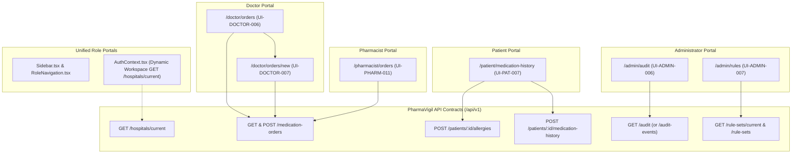

# Implementation Plan: Missing Route Inventory Pages & Tenancy Alignment

**Target Workspace:**
- Frontend: `/run/media/jimfleax/DEV/Projects/PharmaVigil-frontend`
- Backend Reference: `/run/media/jimfleax/DEV/Projects/PharmaVigil`
- Specification Reference: `docs/02-frontend/route-inventory.md`, `docs/04-contracts/openapi.yaml`

---

## 1. Executive Summary & Problem Scope

The **PharmaVigil** outpatient medication safety platform has robust implementations for its primary prescription capture, OCR extraction review, safety rule checking, clinician disposition, and dispensing authorization workflows. However, an audit against `docs/02-frontend/route-inventory.md` reveals six missing routes across Doctor, Pharmacist, Patient, and Administrator portals, alongside hardcoded hospital tenancy in `AuthContext`:

1. **Doctor Inpatient Orders (`UI-DOCTOR-006`: `/doctor/orders`)**: Missing inpatient medication orders list and schedule reviewer.
2. **Doctor Prescribe Inpatient Order (`UI-DOCTOR-007`: `/doctor/orders/new`)**: Missing inpatient order prescription form with inpatient schedule frequencies (`Q8H`, `BID`, `TID`, `QID`, `STAT`), administration routes (`IV`, `PO`, `SC`, `IM`), start/end dates, and clinical notes.
3. **Pharmacist Inpatient Queue (`UI-PHARM-011`: `/pharmacist/orders`)**: Missing pharmacist queue for reviewing active inpatient medication orders.
4. **Patient Self-Reporting Hub (`UI-PAT-007`: `/patient/medication-history`)**: Missing self-reporting portal for patients to declare home medications and allergies via `POST /patients/:id/allergies` and `POST /patients/:id/medication-history` (enforcing `PATIENT_REPORTED` and `REPORTED` verification status).
5. **Admin Audit Search (`UI-ADMIN-006`: `/admin/audit`)**: Missing hospital compliance audit log search with filters for `actorUserId`, `resourceType`, date/cursor pagination, and metadata inspector.
6. **Admin CDS Rulesets Viewer (`UI-ADMIN-007`: `/admin/rules`)**: Missing published clinical decision support rulesets explorer showing active rule counts, validation status badges, and explicit clinical limitations.
7. **Hardcoded Tenancy in `AuthContext`**: `AuthContext.tsx` currently hardcodes `hospitalName = "Metro General Hospital"` instead of dynamically resolving the active hospital workspace via `GET /api/v1/hospitals/current` or user membership.
8. **Navigation & Breadcrumb Gaps**: `Sidebar.tsx`, `RoleNavigation.tsx`, and `Breadcrumbs.tsx` lack routes and labels for these six pages.

---

## 2. Architectural Blueprint & Data Flow



---

## 3. Detailed Route Specifications & UX Design

### 3.1. Doctor Inpatient Orders: `UI-DOCTOR-006` (`/doctor/orders`)
- **Route Path:** `src/app/doctor/orders/page.tsx`
- **Role Guard:** `DOCTOR` (hospital-scoped)
- **Primary Backend Operation:** `GET /medication-orders?status=&patientId=&limit=&cursor=`
- **Layout & Visual Hierarchy:**
  - Header with page title (`ListOrdered` icon), count metric badge, and primary action button `+ Prescribe Inpatient Order` leading to `/doctor/orders/new`.
  - Filter bar: Status segmented filter (`ALL`, `ACTIVE`, `DISCONTINUED`, `CANCELLED`), synthetic patient ID filter input (`P-9021`).
  - Responsive Inpatient Orders Table:
    - **Order ID:** Monospace badge with version indicator (e.g., `ord_inpatient_01`, `v1`).
    - **Patient:** Synthetic ID (`P-9021`) + Name (`Rajan Sharma`).
    - **Ordered Medications:** Ingredient, dose, route (`IV`, `Oral`), and frequency (`Q8H`, `BID`, `STAT`).
    - **Status:** Emerald badge for `ACTIVE`, Slate badge for `DISCONTINUED`, Amber for `CANCELLED`.
    - **Ordering Doctor:** Clinician display name and ordering date.
    - **Actions:** "View Schedule Details" (opens slide-over modal) & "Revise Order" button.
  - Detail Modal: Shows full version lineage, notes, administration schedule details, and discontinuation reasons if applicable.
  - States: Loading skeleton table, EmptyState when no matching orders exist, ErrorDisplay with retry.

### 3.2. Doctor Prescribe Inpatient Order: `UI-DOCTOR-007` (`/doctor/orders/new`)
- **Route Path:** `src/app/doctor/orders/new/page.tsx`
- **Role Guard:** `DOCTOR`
- **Primary Backend Operation:** `POST /medication-orders` (Idempotent)
- **Form Architecture & Fields:**
  - **Patient Selection:** Dropdown/autocomplete targeting hospital synthetic patient records (`P-9021 Rajan Sharma` auto-selected in demo mode).
  - **Medication Item Repeater (1..N items):**
    - **Catalogue Drug Search:** Async search via `api.searchCatalogue` with auto-filling canonical ingredients, dosage forms, and brand names.
    - **Dose & Strength:** `doseValue` (number), `doseUnit` (`mg`, `g`, `mcg`, `mL`, `tablets`), `strengthValue`, `strengthUnit`.
    - **Administration Route:** Dropdown selecting `INTRAVENOUS (IV)`, `ORAL (PO)`, `SUBCUTANEOUS (SC)`, `INTRAMUSCULAR (IM)`, `INHALATION`, `TOPICAL`, `SUBLINGUAL`.
    - **Inpatient Schedule Frequency:** Select dropdown standard clinical frequencies:
      - `Q8H` (Every 8 hours - 3 times daily)
      - `Q12H` (Every 12 hours - twice daily)
      - `Q24H / QD` (Every 24 hours - once daily)
      - `BID` (Twice daily with meals)
      - `TID` (Three times daily)
      - `QID` (Four times daily)
      - `STAT` (Immediately - single administration)
      - `PRN` (As needed for pain/symptoms)
    - **Duration & Date Limits:** Start Date picker, Duration value + unit (`days`, `hours`, `doses`), and calculated End Date.
    - **Specific Administration Instructions:** E.g., "Infuse in 100mL 0.9% NaCl over 60 minutes".
  - **Order Notes & Rationale:** Multiline clinical notes for nursing/pharmacy staff.
  - **Validation & Safety Gates:**
    - At least 1 complete medication item required.
    - Dose value must be positive numeric.
    - Inpatient schedule must be specified.
  - **Toast & Navigation:** Sonner notification upon successful creation (`Order #ord_... successfully submitted`), redirect to `/doctor/orders`.

### 3.3. Pharmacist Inpatient Orders Queue: `UI-PHARM-011` (`/pharmacist/orders`)
- **Route Path:** `src/app/pharmacist/orders/page.tsx`
- **Role Guard:** `PHARMACIST`
- **Primary Backend Operation:** `GET /medication-orders` and `GET /medication-orders/:id`
- **Layout & Visual Hierarchy:**
  - Header: Inpatient Dispensing & Verification Queue (`BedDouble` or `PackageCheck` icon).
  - Metric Strip: Active Inpatient Orders, IV Infusions Scheduled, STAT Orders Requiring Urgent Release.
  - Orders Queue Grid / Table:
    - Order ID, Patient Bed/Ward ID, Patient Name.
    - High-Alert Medication Badges (e.g., IV Vancomycin, Heparin, Insulin).
    - Schedule frequency (`Q8H`, `Q12H`, etc.).
    - Order status and ordering clinician.
  - Pharmacist Inpatient Review Dialog:
    - Compares ordered dosing against standard renal/weight thresholds.
    - Clinical confirmation checklist ("Schedule timing verified", "Route compatibility confirmed").
    - Action buttons: "Acknowledge Inpatient Schedule", "Hold for Doctor Inquiry".
  - Full loading skeleton and empty state.

### 3.4. Patient Self-Reported History & Allergies: `UI-PAT-007` (`/patient/medication-history`)
- **Route Path:** `src/app/patient/medication-history/page.tsx`
- **Role Guard:** `PATIENT` (linked patient profile)
- **Primary Backend Operations:**
  - Profile & Linking: `GET /patient/me/summary`
  - Fetch Allergies: `GET /patients/:id/allergies`
  - Fetch Med History: `GET /patients/:id/medication-history`
  - Create Allergy: `POST /patients/:id/allergies` (Server forces `sourceType: 'PATIENT_REPORTED'`, `verificationStatus: 'REPORTED'`)
  - Create Med History: `POST /patients/:id/medication-history` (Server forces `sourceType: 'PATIENT_REPORTED'`, `verificationStatus: 'REPORTED'`)
- **Clinical Safety Disclaimer:**
  - Amber callout banner: *"Self-reported medications and allergies are visible to your healthcare team with a 'Patient-Reported' verification badge. Your physician or pharmacist will formally verify these entries during your next clinical visit."*
- **Two Interactive Tabs (HeroUI SegmentedControl or Radix Tabs):**
  - **Tab A: "Known Allergies & Adverse Reactions"**
    - Table / Cards of existing allergies with `MILD`, `MODERATE`, `SEVERE`, `LIFE_THREATENING` severity badges, reaction text, and `REPORTED` verification badge.
    - "Add Known Allergy" Form:
      - Substance / Allergen name (e.g., "Penicillin", "Sulfa drugs", "Peanuts").
      - Record Type: `ALLERGY` (immune-mediated) vs `INTOLERANCE` (adverse effect).
      - Severity: `MILD`, `MODERATE`, `SEVERE`, `LIFE_THREATENING`.
      - Reaction description: Checkboxes/text for hives, rash, anaphylaxis, facial swelling, nausea.
    - Sonner toast confirmation on save.
  - **Tab B: "Home Medications & Over-The-Counter Supplements"**
    - List of current home medications, dosages, routes, and frequencies.
    - "Add Home Medication" Form:
      - Medication / Supplement Name (e.g., "Metformin", "Omega-3 Fish Oil").
      - Dose & Unit (e.g., "500", "mg").
      - Route (`Oral`, `Topical`, `Inhalation`, `Eye drops`).
      - Frequency (`Once daily`, `Twice daily`, `As needed`).
      - Status (`ACTIVE` or `STOPPED`).
      - Approximate Start Date.
    - Sonner toast confirmation on save.

### 3.5. Admin Audit Log Search: `UI-ADMIN-006` (`/admin/audit`)
- **Route Path:** `src/app/admin/audit/page.tsx`
- **Role Guard:** `HOSPITAL_ADMIN`
- **Primary Backend Operation:** `GET /audit` (or `/audit-events`) with query params: `resourceType`, `actorUserId`, `limit`, `cursor`.
- **Search & Filter Controls:**
  - Resource Type Selector: Dropdown containing all domain entities:
    - `All Resources`
    - `Prescription`
    - `PrescriptionRevision`
    - `PrescriptionCapture`
    - `CheckRun`
    - `Alert`
    - `AlertDisposition`
    - `DispensingAuthorization`
    - `MedicationOrder`
    - `Membership`
    - `User`
    - `DemoWorkspace`
  - Actor User ID search input (filter by clinician or administrator).
  - Limit selector: `10`, `20`, `50`, `100`.
- **Audit Table Display:**
  - **Timestamp:** Formatted ISO date + exact time (`font-mono font-tabular text-slate-600`).
  - **Actor:** Display name + User ID + Role badge.
  - **Action:** Color-coded action verb (e.g., `CREATE_MEDICATION_ORDER`, `RECORD_DISPOSITION`, `AUTHORIZE_DISPENSING`, `APPROVE_MEMBERSHIP`, `SYSTEM_RESET`).
  - **Resource Type & ID:** Badge + Monospace ID.
  - **Inspect JSON:** Button opening a clean slide-over drawer showing raw event metadata (`requestId`, changes, context).
- **Pagination:** Previous / Next cursor-based controls.

### 3.6. Admin Clinical Rulesets Viewer: `UI-ADMIN-007` (`/admin/rules`)
- **Route Path:** `src/app/admin/rules/page.tsx`
- **Role Guard:** `HOSPITAL_ADMIN` (also viewable by `DOCTOR`)
- **Primary Backend Operations:**
  - `GET /rule-sets/current` (returns `RuleSetMetadata`)
  - `GET /rule-sets` (returns `ClinicalRuleSetDocument[]`)
- **Hero Metric Strip & Governance Summary:**
  - **Active Version:** `v1.0.0-illustrative` (Monospace badge).
  - **Rule Count:** Total published rules (e.g., 14 active rules).
  - **Validation Status:** Amber badge `ILLUSTRATIVE_NOT_VALIDATED` with explicit warning: *"Rules are illustrative demonstration rulesets; not clinically validated for diagnostic or unverified treatment decisions."*
  - **Published Date:** Formatted timestamp and publisher user ID.
- **Explicit Clinical Limitations Banner:**
  - Callout box listing limitations directly from `ruleSet.limitations` (e.g., *"Food/drink interaction evaluation not supported"*, *"Paediatric dosing ranges outside scope"*).
- **Rules Explorer Table:**
  - Filter by Rule Category: `Drug-Drug Interaction (DDI)`, `Dose Range Check`, `Duplicate Therapy`, `Allergy Cross-Reactivity`.
  - Filter by Severity: `CRITICAL`, `HIGH`, `MODERATE`, `LOW`.
  - Table Columns:
    - Rule ID (e.g., `RULE-DDI-WARFARIN-NSAID`).
    - Severity Badge.
    - Trigger Condition / Target Ingredients.
    - Clinical Description & Mechanistic Rationale.
    - Actionable Recommendation (e.g., "Discontinue concomitant NSAID therapy or prescribe gastroprotective agent").
    - Guideline Reference / Monograph Citation.

---

## 4. Tenancy Alignment in `AuthContext`

### Current Anti-Pattern in `src/context/AuthContext.tsx`
```tsx
// Current hardcoded implementation:
const [hospitalName, setHospitalName] = useState<string>("Metro General Hospital");
...
setHospitalName("Metro General Hospital");
```

### Proposed Tenancy Alignment
1. Add `getCurrentHospital(): Promise<Hospital>` to `src/lib/api-client.ts`:
   - In real API mode: calls `GET /api/v1/hospitals/current` with credentials.
   - In mock mode: delegates to `mockEngine.getCurrentHospital()`.
2. Update `src/context/AuthContext.tsx`:
   - Store both `hospital: Hospital | null` and `hospitalName: string`.
   - In `refreshSession()` and `login()`:
     - After fetching current user and active membership, execute `api.getCurrentHospital()`.
     - Update `hospital` state and set `hospitalName` to `res.name || activeMem?.hospitalId || "Hospital Workspace"`.
     - Gracefully fallback to default hospital if network fails or in offline demo mode.
   - Export `hospital` in `AuthContextType`.
3. Update `src/app/layout.tsx` and `src/components/layout/AppHeader.tsx`:
   - Bind footer and header hospital badges directly to dynamic `hospitalName` from `useAuth()`.

---

## 5. Navigation & Breadcrumb Integration

### 5.1. `Sidebar.tsx` Additions
Add new items under corresponding role portals:
- **`DOCTOR`**:
  - Add `{ label: "Inpatient Orders", href: "/doctor/orders", icon: ListOrdered }`
- **`PHARMACIST`**:
  - Add `{ label: "Inpatient Queue", href: "/pharmacist/orders", icon: BedDouble }`
- **`PATIENT`**:
  - Add `{ label: "Reported Meds & Allergies", href: "/patient/medication-history", icon: ShieldAlert }`
- **`HOSPITAL_ADMIN`**:
  - Add `{ label: "Audit Log Search", href: "/admin/audit", icon: FileSearch }`
  - Add `{ label: "Clinical Rulesets", href: "/admin/rules", icon: BookOpenCheck }`

### 5.2. `RoleNavigation.tsx` Additions
Mirror all new navigation items for mobile and tablet horizontal tab navigation.

### 5.3. `Breadcrumbs.tsx` Label Map
Update `ROUTE_LABELS` to cleanly format route segments:
```tsx
orders: "Inpatient Orders",
audit: "Audit Search",
rules: "Clinical Rulesets",
"medication-history": "Self-Reported History",
```

---

## 6. Mock Engine & API Client Support

To guarantee seamless operation both in live API mode and in offline/demo mock mode, update `src/lib/mock-client.ts` and `src/lib/api-client.ts`:

1. **`src/lib/mock-data/fixtures.ts`**:
   - Seed `INITIAL_MEDICATION_ORDERS` with 2 representative inpatient orders (`ord_inpatient_9021_01` for patient `P-9021` with Ceftriaxone 1g IV Q24H and Vancomycin 1g IV Q12H).
   - Seed `INITIAL_AUDIT_EVENTS` with realistic events (`CREATE_PRESCRIPTION`, `RUN_CHECK`, `RECORD_DISPOSITION`, `AUTHORIZE_DISPENSING`, `DEMO_RESET`).
   - Seed `INITIAL_RULE_SET` with metadata and 6 clinical rules from `seed-catalogue-rules.ts`.
2. **`src/lib/mock-client.ts`**:
   - Add state fields: `medicationOrders`, `auditEvents`, `ruleSets`, `allergies`, `medicationHistory`.
   - Implement mock handlers:
     - `getCurrentHospital()`
     - `listMedicationOrders(filter)`
     - `getMedicationOrder(id)`
     - `createMedicationOrder(data)`
     - `listAuditEvents(filter)`
     - `getCurrentRuleSet()`
     - `listRuleSets(filter)`
     - `getAllergies(patientId)`
     - `addAllergy(patientId, data)` (forces `sourceType: 'PATIENT_REPORTED'`, `verificationStatus: 'REPORTED'`)
     - `getMedicationHistory(patientId)`
     - `addMedicationHistory(patientId, data)` (forces `sourceType: 'PATIENT_REPORTED'`, `verificationStatus: 'REPORTED'`)
3. **`src/lib/api-client.ts`**:
   - Expose corresponding public typed methods wrapping HTTP calls and mock engine fallbacks.

---

## 7. Toast Notification System Setup

Install and configure `sonner`:
1. **Dependency Installation**: `npm install sonner` in `PharmaVigil-frontend`.
2. **Provider Integration**: Add `<Toaster position="top-right" richColors closeButton />` in `src/app/layout.tsx`.
3. **Usage in Components**:
   - Order creation: `toast.success("Inpatient order submitted successfully")`
   - Patient allergy/medication self-report: `toast.success("Allergy record submitted for clinical review")`
   - Filter reset or copy actions: `toast.info("Audit filters reset")`
   - Validation or conflict errors: `toast.error(error.message)`

---

## 8. TDD Verification Plan

Create dedicated Vitest test suites under `tests/`:

### 8.1. Inpatient Orders Test Suite (`tests/inpatient-orders.test.tsx`)
- **TEST-ORD-001 (Doctor Inpatient Prescribing)**: Verify doctor can prescribe an inpatient order with `patientId`, `items` containing schedule `Q8H`, route `INTRAVENOUS`, and notes; returns 201 Created and persists order with `status: "ACTIVE"`.
- **TEST-ORD-002 (Order Validation Gate)**: Verify submitting an order without medication items throws validation error and does not mutate state.
- **TEST-ORD-003 (Pharmacist Queue Listing)**: Verify pharmacist can query active inpatient orders and filter by status `ACTIVE`.
- **TEST-ORD-004 (Order Schedule Details)**: Verify order details modal loads versions lineage and items accurately.

### 8.2. Patient Self-Reporting Test Suite (`tests/patient-self-reporting.test.tsx`)
- **TEST-PAT-001 (Forced Patient-Reported Allergy)**: Verify patient submitting `POST /patients/:id/allergies` records entry with server-enforced `sourceType: "PATIENT_REPORTED"` and `verificationStatus: "REPORTED"`.
- **TEST-PAT-002 (Forced Patient-Reported Medication History)**: Verify patient submitting `POST /patients/:id/medication-history` records entry with server-enforced `sourceType: "PATIENT_REPORTED"` and `verificationStatus: "REPORTED"`.
- **TEST-PAT-003 (Patient Validation Gate)**: Verify blank substance name or missing required dose fields reject with validation errors.
- **TEST-PAT-004 (Safety Notice Presence)**: Verify rendered page contains clear disclaimer that self-reported records require clinician verification.

### 8.3. Admin Governance & CDS Rulesets Test Suite (`tests/admin-governance.test.tsx`)
- **TEST-ADM-001 (Audit Search Filtering)**: Verify admin audit search filters events by `resourceType` (`Prescription`, `MedicationOrder`) and `actorUserId`.
- **TEST-ADM-002 (Audit Detail Inspection)**: Verify selecting an audit row reveals formatted JSON metadata including `requestId` and timestamp.
- **TEST-ADM-003 (CDS Ruleset Metadata)**: Verify rules page displays active ruleset version, rule count, and `ILLUSTRATIVE_NOT_VALIDATED` status.
- **TEST-ADM-004 (CDS Limitations Callout)**: Verify clinical limitations (e.g. food/drink interactions outside scope) are rendered prominently in the UI.

### 8.4. Tenancy & Route Guards Test Suite (`tests/tenancy-and-navigation.test.tsx`)
- **TEST-TEN-001 (Dynamic Hospital Fetch)**: Verify `AuthContext` calls `GET /hospitals/current` upon login and replaces hardcoded workspace with dynamic hospital name.
- **TEST-NAV-001 (Role Navigation Guarding)**: Verify doctor sidebar includes `/doctor/orders`, pharmacist includes `/pharmacist/orders`, patient includes `/patient/medication-history`, and admin includes `/admin/audit` and `/admin/rules`.

---

## 9. Horizontal Phase-Based Delivery & Rollout Plan

| Phase | Tasks & Deliverables | Verification Milestone |
|---|---|---|
| **Phase 1: Foundation & Tenancy Alignment** | - Install `sonner`<br>- Add `<Toaster />` in `layout.tsx`<br>- Expose new API client methods & mock engine fixtures<br>- Update `AuthContext.tsx` to dynamically query `/hospitals/current`<br>- Update `Sidebar.tsx`, `RoleNavigation.tsx`, `Breadcrumbs.tsx` | Run `npm test` verifying tenancy and navigation link tests pass. |
| **Phase 2: Doctor Inpatient Orders** | - Build `/doctor/orders` (list, status filters, search, modal)<br>- Build `/doctor/orders/new` (schedule dropdown `Q8H`/`BID`/`STAT`, routes, multi-item repeater, Zod validation, toast) | Run `vitest run tests/inpatient-orders.test.tsx` verifying creation and listing. |
| **Phase 3: Pharmacist Inpatient Queue** | - Build `/pharmacist/orders` (review queue, ward filter, verification checklist, schedule confirmation dialog) | Verify pharmacist queue renders correctly with exact skeletons. |
| **Phase 4: Patient Self-Reporting Hub** | - Build `/patient/medication-history` (Allergies tab, Home meds tab, forced `PATIENT_REPORTED` badges, report dialogs, sonner feedback) | Run `vitest run tests/patient-self-reporting.test.tsx`. |
| **Phase 5: Admin Audit & CDS Rulesets** | - Build `/admin/audit` (filter toolbar, responsive audit table, JSON detail drawer)<br>- Build `/admin/rules` (summary metrics, limitations banner, categorized rule explorer) | Run `vitest run tests/admin-governance.test.tsx`. |
| **Phase 6: Full Integration & Visual Regression** | - Execute all 6 test suites<br>- Run build check (`npm run build`)<br>- Capture responsive screenshots at 1440px, 1024px, 768px, 375px | Zero TypeScript errors, 100% test pass rate, clean layout across all portals. |
